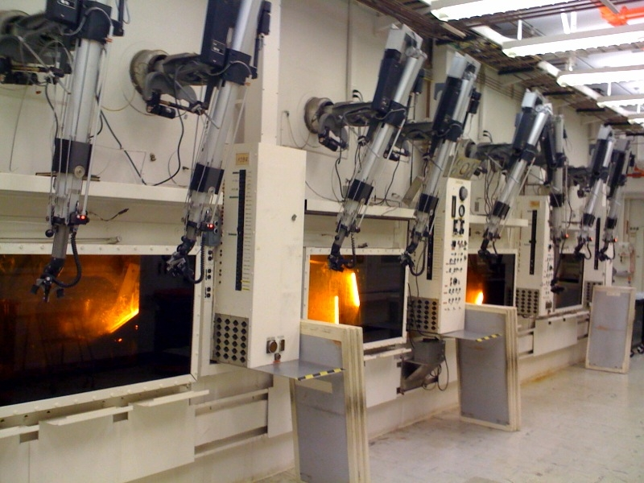
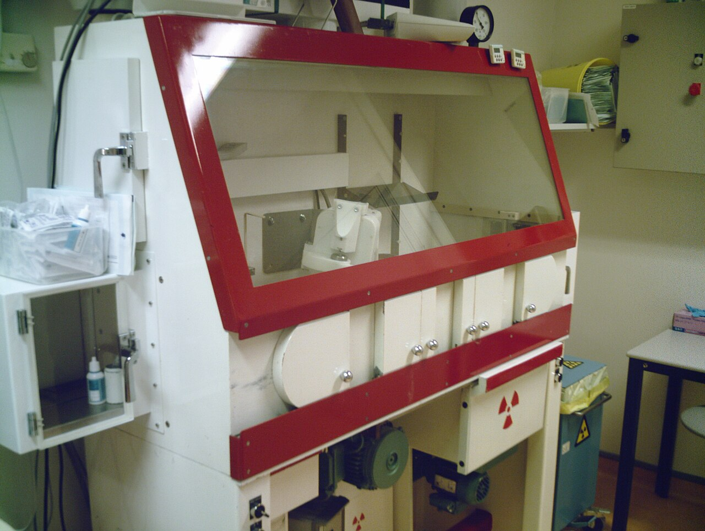
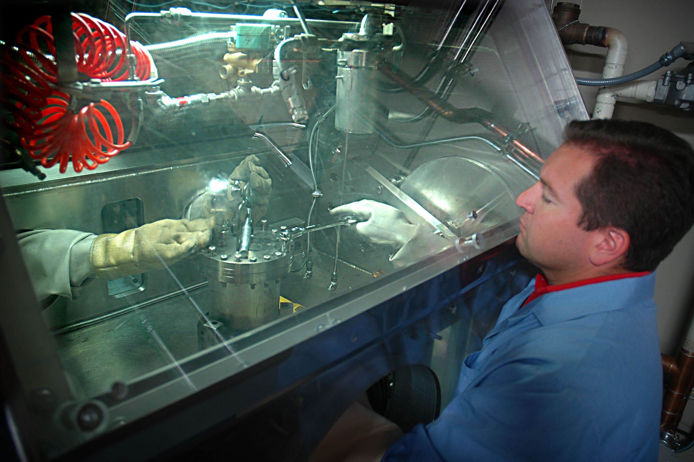
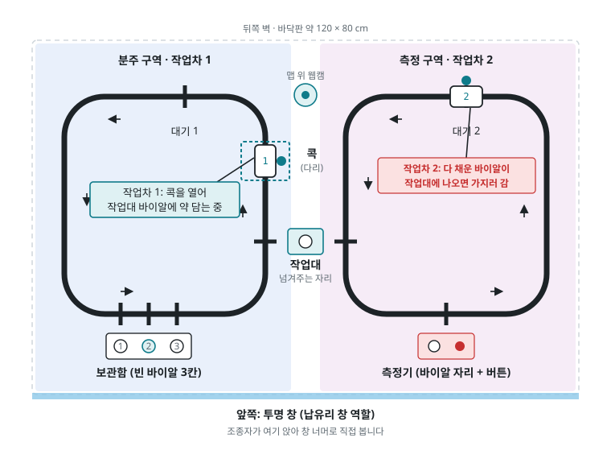

# ProxyHand 기획서_이보연

* 작성일: 2026-11-16
* 수정일: 2026-11-17 (시연 순서를 콕 → 버튼으로 변경, 7장에 작업차 2대의 역할 분담 추가, 3·6·9장에 여러 대 감독 내용 추가, 측정기 투입구와 반복 횟수 반영)
* 기반 문서: EchoHand 추가 조사\_이보연, AiHand 확장 아이디어 탐색\_이보연, 팀원 아이디어 "위험 환경 원격조작 핸드"
* 목적: EchoHand 대신 새 아이디어 ProxyHand를 제안합니다. 왜 방향을 바꿨는지, 어떤 현장의 어떤 불편을 풀려는지 멘토님께 설명드리고 피드백을 받습니다.

## 한 줄 소개

> **"사람 대신 위험 구역에 들어가고, 한 번 보여 주면 혼자 반복하는 손"**

* **이름:** Proxy는 "대리인, 대신하는 것"이라는 뜻입니다. 사람 대신 위험한 곳에 들어가 사람 대신 일하는 손이라는 의미입니다.
* **현장:** 방사성 물질을 다루는 **핫셀**과 **글러브박스**
* **핵심 기능:** ① 작업자의 손동작을 그대로 따라 하는 원격 조작, ② 한 번 시범을 보이면 기억했다가 혼자 반복, ③ 물건 위치가 바뀌어도 스스로 찾아가서 작업

## 1. 왜 EchoHand가 아니라 ProxyHand인가

### EchoHand에서 풀리지 않은 질문

EchoHand는 "화면보다 손이 낫다"는 근거를 모았지만, 조사를 이어 갈수록 **더 강한 경쟁자는 화면이 아니라 기계마다 달린 램프와 버튼**이라는 점이 드러났습니다.

| EchoHand가 내세운 장점 | 램프와 버튼으로도 되는가 |
| --- | --- |
| 특정한 사람을 지목함 | ✅ 기계마다 램프를 달면 됨 |
| 움직임으로 주의를 끎 | ✅ 깜빡이면 됨 |
| 신호 종류를 구분함 | ✅ 색이나 숫자로 됨 |
| 복창으로 확인함 | ✅ 버튼이 더 빠르고 정확함 |
| 같은 모양으로 따라 하게 만듦 | ❌ 손만 가능, 그러나 현장이 원하는 기능은 아님 |

* 공장이 원하는 것은 "확인이 되는 것"이지 "손짓으로 확인하는 것"이 아닙니다.
* 관리자의 진짜 불편(자재 부족, 호출 응답 지연)은 센서가 자동으로 알려 주는 방향으로 풀리고 있습니다. EchoHand는 반대로 사람에게 신호 일을 하나 더 맡깁니다.
* 결과적으로 "**있으면 신기하지만 돈 내고 살 이유는 약한 제품**"이 될 위험이 컸습니다.

### 두 아이디어 비교

| 기준 | EchoHand | ProxyHand |
| --- | --- | --- |
| 풀려는 불편이 분명한가 | ⚠️ 램프·버튼으로 해결됨 | ✅ 사람이 위험에 노출됨 |
| 돈을 낼 곳이 분명한가 | ⚠️ 제조 공장, 우선순위 낮음 | ✅ 방사성의약품 제조사, 병원, 원자력 시설 |
| "왜 손인가"에 답할 수 있나 | ❌ 램프와 차이가 작음 | ✅ 사람용 물건을 그대로 다루고, 도구를 바꿀 필요가 없음 |
| AiHand의 약한 힘 | ✅ 문제 없음 | ⚠️ 약점. 가벼운 물건이 많은 현장을 골라 보완 |
| 경쟁 | 거의 없음 (수요도 약함) | 있음 → 차별점이 필요 (6장) |

ProxyHand는 구현이 더 어렵지만, **"이 불편이 실제로 있는가"라는 가장 중요한 질문에 분명하게 답할 수 있어** 방향을 바꾸기로 했습니다.

## 2. 문제: 핫셀과 글러브박스 작업의 불편

### 핫셀이란

방사성 물질을 다루기 위해 **납 벽과 납유리 창으로 막은 작업 상자**입니다. 작업자는 바깥에서 창으로 안을 보며, 벽을 관통한 **기계식 원격조작기**(집게 팔)로 안쪽 물건을 다룹니다.

*원자력 연구소의 핫셀. 창 위로 보이는 긴 팔이 기계식 원격조작기로, 작업자가 바깥 손잡이를 움직이면 안쪽 집게가 따라 움직입니다. (사진: Argonne National Laboratory, [Wikimedia Commons](https://commons.wikimedia.org/wiki/File:Alpha-Gamma_Hot_Cell_Facility_001.jpg))*

병원에도 작은 핫셀이 있습니다. 암 진단에 쓰는 방사성의약품(테크네튬-99m 등)을 환자에게 투여하기 전에 이 안에서 준비합니다.

*병원에서 방사성의약품을 준비하는 핫셀. 차폐 창 안에서 바이알(작은 약병)과 주사기를 다룹니다. (사진: Jejecam, CC BY-SA 3.0, [Wikimedia Commons](https://commons.wikimedia.org/wiki/File:Hotte_pour_technetium.jpg))*

### 글러브박스란

밀폐된 상자 벽에 장갑이 붙어 있어, 작업자가 **장갑에 손을 넣어 안쪽 물건을 직접 다루는 장비**입니다. 손재주는 좋지만 작업자의 손과 위험 물질 사이에 장갑 한 겹만 있습니다.

*원자력 연구소에서 글러브박스로 방사성 부품을 다루는 모습. 작업자는 장갑 너머로 렌치와 볼트를 직접 다룹니다. (사진: Idaho National Laboratory, CC BY 2.0, [Wikimedia Commons](https://commons.wikimedia.org/wiki/File:Glovebox_INL.jpg))*

### 지금 겪는 불편

| 불편 | 내용 | 출처 |
| --- | --- | --- |
| ① 피폭·오염 위험 | 글러브박스는 장갑이 찢어지면 작업자가 방사성 물질에 노출될 수 있고, 작업 자체도 몸이 힘듦 | [Valkyrie 원격조작 연구 (OSTI)](https://www.osti.gov/biblio/22977740-remotely-teleoperating-humanoid-robot-perform-fine-motor-tasks-virtual-reality) |
| ② 기계식 조작기는 둔하고 힘듦 | 손이 닿는 범위와 정교함은 주지만 **들어 올리는 힘은 작업자 근력에 의존**함. 반복 작업 때문에 근골격계 부담이 생겨 조작기를 로봇으로 바꾸는 제품까지 나옴 | [Cleanroom Technology](https://cleanroomtechnology.com/manipulators-a-gamechanger-in-radiopharmaceutical-production-170880) |
| ③ 조작이 직관적이지 않음 | 국내 원자력연구원은 원전 해체용 원격조작기가 산업화되지 못한 이유를 "하드웨어가 아니라 **원격 조작 기술의 미성숙**"으로 진단하고, 기존 조작기는 직관성이 부족하다고 지적함 | [KoreaScience (원자력연구원)](https://koreascience.kr/article/JAKO201321365239094.pdf) |
| ④ 도구를 바꾸기 어려움 | 밀폐된 공간이라 안에 있는 집게나 도구를 바꿔 끼우려면 번거로운 반입·반출 절차가 필요함. 그런데 안의 물건(바이알, 뚜껑, 버튼, 콕)은 모두 **사람 손에 맞춰 만든 것**임 | — |

## 3. 대상 현장과 사용자

### 대상 현장

| 현장 | 하는 일 | 우선순위 |
| --- | --- | --- |
| 방사성의약품 제조사 | 암 진단·치료용 방사성의약품을 핫셀 안에서 만들고 나눠 담음 | **1순위** |
| 병원 핵의학과 | 환자에게 투여할 방사성의약품을 핫셀 안에서 준비 | 1순위 |
| 원자력 연구시설, 원전 해체 | 글러브박스·핫셀 안에서 시료와 폐기물을 다룸 | 2순위 (다루는 물건이 더 무거움) |

이 현장들은 **다루는 물건이 가볍고(바이알, 뚜껑, 버튼), 같은 절차를 하루에도 여러 번 반복**합니다. AiHand의 약한 힘이 덜 문제가 되고, "가르치면 혼자 반복"하는 기능이 가장 잘 맞습니다.

### 누가 무엇이 나아지나

| 사용자 | 지금 | ProxyHand를 쓰면 |
| --- | --- | --- |
| 작업자 | 기계식 조작기를 팔 힘으로 움직이거나, 장갑에 손을 넣어 위험 물질 가까이에서 작업 | 자기 손을 움직이기만 하면 로봇손이 따라 함. 반복 작업은 로봇이 혼자 하고 작업자는 감독만 함 |
| 관리자 | 작업자의 피폭량과 근골격 부담을 관리해야 하고, 숙련자에게 작업이 몰림 | 위험 구역 노출 시간이 줄고, 숙련자의 작업을 한 번 녹화해 반복시킬 수 있음. 작업자 한 명이 로봇 여러 대를 감독하며 여러 작업을 동시에 맡을 수 있음 |

## 4. 해결 방법

ProxyHand는 사용자 입장에서 세 단계로 씁니다.

| 단계 | 작업자가 하는 일 | ProxyHand가 하는 일 |
| --- | --- | --- |
| **① 원격 조작** | 위험 구역 밖에서 카메라 앞에 손을 움직임 | 위험 구역 안에서 그 손동작을 그대로 따라 함 |
| **② 가르치기** | 같은 작업을 한 번 시범으로 보여 줌 | 손가락 모양, 손 회전, 이동 순서를 기억함 |
| **③ 혼자 하기** | 시작만 누르고 화면으로 지켜봄 | 기억한 작업을 혼자 반복함. **물건 위치가 바뀌어도 스스로 찾아가서** 작업함 |

**예시:** 작업자가 "바이알을 집어 작업대로 옮기기"를 한 번 손으로 보여 줍니다. 그다음부터는 바이알이 보관함 어디에 놓여 있든 ProxyHand가 찾아가 집어서 옮깁니다. 처음 보는 작업이 생기면 작업자가 다시 ①로 직접 조종합니다.

> 지금의 산업용 로봇은 엔지니어가 좌표를 하나하나 입력해 가르쳐야 합니다. ProxyHand는 **현장 작업자가 자기 손으로 해 보이면** 그것이 곧 작업 순서가 됩니다.

## 5. 왜 손인가

| 비교 대상 | 한계 | ProxyHand |
| --- | --- | --- |
| 그리퍼 (집게) | 집기는 잘하지만 누르기는 어색함. 작업이 바뀌면 도구를 바꿔야 하는데 밀폐 공간에서는 어려움 | 손 하나로 **집기·누르기·돌리기**를 도구 교체 없이 함 |
| 기계식 원격조작기 | 둔하고 팔 힘이 들며, 사람이 계속 붙어 있어야 함 | 손동작을 그대로 따라 하고, 반복 작업은 혼자 함 |
| 일반 산업용 로봇 | 정해진 작업은 잘하지만 가르치려면 엔지니어가 필요함 | 작업자가 시범으로 직접 가르침 |

핫셀 안의 물건은 모두 사람 손에 맞춰 만들어졌습니다. 그래서 **사람 손 모양의 로봇이 사람용 물건을 개조 없이 그대로 다루는 것**이 ProxyHand가 손이어야 하는 이유입니다. 사람 손 모양이라 작업자의 손동작이 그대로 옮겨져, 가르치기도 쉬워집니다.

## 6. 기존 사례와 차별점

| 사례 | 내용 | 출처 |
| --- | --- | --- |
| Shadow Robot | 장갑을 끼고 사람 손 모양의 로봇손을 원격 조종. 원전·제약 현장을 겨냥하고, 영국 Sellafield 원전의 오염된 글러브박스 해체 과제에 참여 | [Shadow Robot](https://www.shadowrobot.com/teleoperation), [Alpha Glovebox](https://www.shadowrobot.com/alpha-glovebox/) |
| Argonne·ORNL 연구소 | 작업자 팔 동작을 따라 하는 양팔 로봇으로 모의 폐기물 용기를 열고 분류하는 시연. 핫셀·글러브박스를 대체할 수 있다고 봄 (시제품 단계) | [EurekAlert](https://www.eurekalert.org/news-releases/1038034) |
| Lirob | 핫셀 벽의 기계식 원격조작기를 로봇으로 교체하는 제품 | [Cleanroom Technology](https://cleanroomtechnology.com/manipulators-a-gamechanger-in-radiopharmaceutical-production-170880) |
| 미국 UIC | 사람이 조작하는 핫셀 조작기를 손재주 있는 로봇 + AI로 바꿔 작업 시간을 줄이는 과제 | [UIC](https://www-new.evl.uic.edu/projects/isotope-papka) |
| 국내 원자력연구원 | 원전 해체용 원격조작기와 햅틱(촉감 전달) 연구. 2026년부터 방사선 환경 실증 인프라 구축(241억 원) | [KoreaScience](https://koreascience.kr/article/JAKO201321365239094.pdf), [한경](https://www.hankyung.com/amp/202604283073i) |

**시사점:** "위험 구역에서 손을 원격으로 쓴다"는 방향은 해외 연구소와 기업이 이미 검증하고 있고, 국내에도 실증 예산이 생기고 있습니다. 수요가 있다는 근거입니다.

**ProxyHand의 차별점**

1. **카메라만으로 조종:** 비싼 조종 장갑이나 동작 인식 옷 없이 카메라 앞에서 손을 움직이면 됩니다.
2. **작업자가 직접 가르침:** 원격 조작에서 끝나지 않고, 한 번 시범을 보이면 혼자 반복합니다. 원자력연구원이 지적한 "조작 기술의 미성숙"을 직접 겨냥합니다.
3. **가벼운 물건 반복 작업에 집중:** 큰 힘이 필요한 원전 해체 대신, 가볍고 반복적인 방사성의약품 작업부터 시작합니다.
4. **한 사람이 여러 대를 감독:** 작업자 한 명이 로봇 여러 대가 혼자 일하는 것을 지켜보다가, 평소와 다른 일이 생긴 로봇만 멈추고 직접 조종합니다.

## 7. 시연 시나리오

책상 위 투명 상자를 핫셀로 보고, 투명한 앞면을 납유리 창으로 삼습니다. 작업자는 실제 핫셀처럼 창 앞에서 안을 직접 보며 조종하고, 창으로 잘 안 보이는 손 주변은 카메라 화면으로 보조합니다.

실제 방사성의약품 제조실처럼 **약을 바이알에 담는 일(분주)**과 **방사능 양을 재는 일(측정)**을 작업차 2대가 나눠 맡습니다. 작업차는 로보카 위에 AiHand를 올린 것으로, 바닥의 검정 선을 따라 정거장 사이만 오갑니다. 실제 핫셀 안에서 정해진 레일을 따라 움직이는 로봇과 같은 방식입니다.

*시연 맵. 두 구역은 각자의 길을 갖고, 두 구역 사이의 작업대에서 바이알을 넘겨줍니다.*

| 작업차 | 맡는 일 | 다니는 정거장 |
| --- | --- | --- |
| 작업차 1 (분주) | 빈 바이알을 작업대에 놓고, 콕을 열고 닫아 약을 담음 | 대기 1 → 보관함 → 작업대 → 콕 |
| 작업차 2 (측정) | 약을 담은 바이알을 측정기 투입구에 넣고 시작 버튼을 누름 | 대기 2 → 작업대 → 측정기 |

| 순서 | 시연 내용 | 보여 주는 것 |
| --- | --- | --- |
| ① | 작업차 1: 보관함의 바이알(빈 약병)을 집어 작업대로 옮김 | **집기** + 이동 |
| ② | 작업차 1: 엄지와 검지로 3방향 콕(스톱콕)의 손잡이를 집고 손을 90° 돌려 열고 닫음. 열림 위치에서 LED가 켜짐 | **돌리기** |
| ③ | 작업차 2: 작업대의 바이알을 집어 측정기 투입구에 넣고 시작 버튼을 누름. 넣은 바이알은 아래 수거함으로 떨어짐 | **집기** + **누르기** |
| ④ | ①~③을 한 번씩 가르친 뒤, 두 작업차가 분주와 측정을 나눠 보관함의 바이알 3개가 다 떨어질 때까지 혼자 반복함. 바이알을 보관함의 다른 칸에 놓아도 찾아감 | **가르치기 + 혼자 하기** |
| ⑤ | 혼자 하기 중 한 대를 멈추고 손으로 직접 조종하는 동안, 다른 한 대는 혼자 하기를 계속함 | **여러 대 감독 + 넘겨받기** |

**순서를 정한 이유:** 실제 방사성의약품 준비 순서와 비슷하게 맞췄습니다. 실제로는 빈 바이알을 놓고, 콕을 열어 약을 바이알에 담은 뒤, 측정 장비로 방사능 양을 잽니다. 시연에서는 액체를 쓰지 않고 LED로 약이 흐르는 것을 대신 보여 줍니다.

**② 설치 방법:** 콕을 손 바로 위에 거꾸로 고정해, 콕이 도는 축과 AiHand 받침대가 도는 축을 맞춥니다. 두 축이 같아서 손이 제자리에서 90° 돌면 집혀 있는 손잡이도 함께 돕니다. 콕 손잡이는 AiHand가 집기에 작아서 손잡이에 연장판을 붙입니다. 물을 쓰면 시험 중에 쏟기 쉬워서, 손잡이가 열림 위치까지 돌면 옆에 붙인 스위치가 눌려 LED가 켜지게 해 열림과 닫힘을 보여 줍니다.

**이번 시연에서 보여 주지 않는 것 (확장 계획)**

| 항목 | 이유 |
| --- | --- |
| 무거운 물건 다루기 | AiHand는 서보 힘이 약함. 힘이 센 손으로 바꾸면 해결되는 문제 |
| 촉감 전달 (햅틱) | 작업자가 로봇손이 닿는 느낌을 받는 기능. 별도 장비가 필요 |
| 방사선을 견디는 사양, 실제 핫셀 장착 | 실제 현장 투입 단계에서 필요 |
| 처음 보는 배치나 물건에 대응하는 AI 학습 | 여러 번의 시범 데이터가 쌓인 뒤의 단계 |

핵심 주장인 "**손 하나로 여러 작업을 하고, 가르치면 혼자 한다**"는 이번 시연에서 직접 보여 줍니다.

## 8. 기대 효과와 성과 지표

| 지표 | 의미 |
| --- | --- |
| 위험 구역 노출 시간 | 작업자가 위험 물질 가까이에서 보낸 시간. 시연에서는 0초 |
| 작업 성공률 | 집기·누르기·돌리기 각각의 성공 비율 |
| 혼자 하기 비율 | 전체 반복 작업 중 사람이 조종하지 않고 로봇이 혼자 끝낸 비율 |
| 작업 시간 | 원격 조작으로 할 때와 혼자 하기로 할 때의 소요 시간 비교 |

## 9. 한계와 멘토님께 여쭐 질문

### 한계

* **현장 검증이 아직 없습니다.** 핫셀 작업의 불편은 업체·연구 과제 자료로 확인했고, 실무자 의견은 아직 듣지 못했습니다.
* **경쟁이 있습니다.** Shadow Robot 같은 기업이 이미 비슷한 방향으로 가고 있어, 차별점(카메라 조종, 작업자가 직접 가르치기)을 계속 다듬어야 합니다.
* **AiHand의 힘이 약합니다.** 가벼운 물건 위주의 현장을 골라 보완했지만, 실제 투입에는 더 강한 손이 필요합니다.

### 멘토님께 여쭤볼 질문

* [ ] EchoHand에서 ProxyHand로 방향을 바꾸는 것이 맞다고 보시나요?
* [ ] 방사성의약품 제조·핵의학 핫셀 현장을 1순위로 잡은 것이 적절할까요? 더 맞는 현장이 있을까요?
* [ ] 이 시연(집기·누르기·돌리기 + 가르치면 혼자 하기)이 "왜 손인가"를 설득하기에 충분할까요?
* [ ] 로봇 2대가 분주와 측정을 나눠 맡는 시연이 실제 현장과 맞을까요?

## 출처

* 핫셀·글러브박스 작업: [Cleanroom Technology](https://cleanroomtechnology.com/manipulators-a-gamechanger-in-radiopharmaceutical-production-170880), [Valkyrie 원격조작 연구 (OSTI)](https://www.osti.gov/biblio/22977740-remotely-teleoperating-humanoid-robot-perform-fine-motor-tasks-virtual-reality), [KoreaScience (원자력연구원)](https://koreascience.kr/article/JAKO201321365239094.pdf)
* 기존 사례: [Shadow Robot](https://www.shadowrobot.com/teleoperation), [Shadow Alpha Glovebox](https://www.shadowrobot.com/alpha-glovebox/), [EurekAlert (Argonne·ORNL)](https://www.eurekalert.org/news-releases/1038034), [UIC](https://www-new.evl.uic.edu/projects/isotope-papka), [한경](https://www.hankyung.com/amp/202604283073i)
* 이미지: [Argonne 핫셀](https://commons.wikimedia.org/wiki/File:Alpha-Gamma_Hot_Cell_Facility_001.jpg) (Argonne National Laboratory), [병원 핫셀](https://commons.wikimedia.org/wiki/File:Hotte_pour_technetium.jpg) (Jejecam, CC BY-SA 3.0), [INL 글러브박스](https://commons.wikimedia.org/wiki/File:Glovebox_INL.jpg) (Idaho National Laboratory, CC BY 2.0)
* 내부: EchoHand 추가 조사\_이보연, AiHand 확장 아이디어 탐색\_이보연
