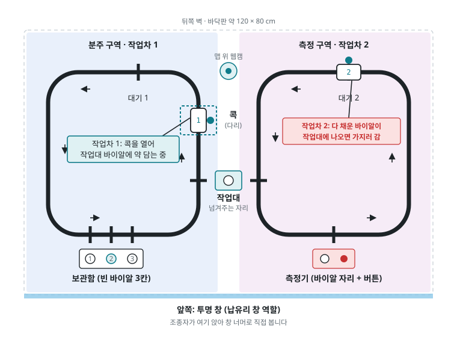

# ProxyHand 시스템 요구사항

* 작성일: 2026-11-17 (수정: 2026-11-18, 바이알 판단·정거장 확인 방법 변경: SR-12~14, SR-23, SR-25, SR-28 / 2026-11-19, SR-32에 손 영상 추가)
* 기반 문서: ProxyHand 기획서\_이보연, ProxyHand 사용자 요구사항\_이보연, ProxyHand 시연 구매 목록\_이보연, AiHand 기술조사\_이보연
* 목적: 사용자 요구사항(UR)을 **시스템이 무엇을 해야 하는지**(SR)로 바꿔 정리합니다. 구현과 시험은 이 목록을 기준으로 합니다.
* 범위: **이번 시연용 시제품**에 한정합니다.
* 관련 문서: 시스템을 **어떻게** 만드는지(하드웨어·소프트웨어 구성, 동작 규칙)는 **ProxyHand 시스템 설계**에, 통신 메시지와 파일 형식은 **ProxyHand 인터페이스 정의**에 있습니다.

> **수치 읽는 법:** "잠정"이 붙은 수치는 이미 잰 값(AiHand 기술조사)과 단계별 예상 시간을 근거로 정한 첫 목표입니다. 1차 시험 후 고칩니다.

## 1. 시스템 개요

ProxyHand는 조종자가 웹캠 앞에서 손을 움직이면 모형 핫셀 안의 로봇손(AiHand)이 그대로 따라 하고, 한 번 보여 준 작업은 혼자 반복하는 시스템입니다. 로봇손은 로보카(Raspbot) 위에 실려 정해진 길을 따라 정거장 사이를 오갑니다. 작업차 2대가 분주와 측정을 나눠 맡습니다.

| 구성 요소 | 개수 | 하는 일 |
| --- | --- | --- |
| 노트북 (Windows) | 1 | 손 인식, 바이알 위치 찾기, 작업 기록·재생, 관제, 웹 조종 화면 |
| 맵 위 웹캠 | 1 | 맵 전체를 위에서 찍어 바이알 위치, 작업대 바이알 유무, 콕 LED 켜짐을 봄 |
| 시연 전용 공유기 | 1 | 노트북과 작업차 2대를 한 Wi-Fi로 연결 |
| 작업차 (Raspbot + AiHand) | 2 | 정거장 이동, 손 작업 |

* 통신: 노트북과 작업차는 Wi-Fi로 **UDP/TCP 메시지**를 주고받습니다. 작업차 안에서 라즈베리 파이와 AiHand(micro:bit)는 USB 선으로 연결합니다.
* AiHand를 로보카 위에 올리는 것은 **시험 후 결정**합니다(8장).

## 2. 시연 환경 (맵)

*그림 1. 위에서 내려다본 맵. 두 구역은 각자의 고리 모양 길을 갖고, 두 고리 사이의 작업대에서 바이알을 넘겨줍니다. 그림 속 작업차 위치는 한 순간의 예시입니다.*

### 구역과 정거장

| 구역 | 작업차 | 정거장 (도는 순서) | 하는 일 |
| --- | --- | --- | --- |
| 분주 구역 | 작업차 1 | 대기 1 → 보관함(1·2·3번 칸) → 작업대 → 콕 → 대기 1 | 빈 바이알을 작업대에 놓고, 콕을 열고 닫아 약을 담음 |
| 측정 구역 | 작업차 2 | 대기 2 → 작업대 → 측정기 → 대기 2 | 약을 담은 바이알을 측정기 투입구에 넣고 시작 버튼을 누름 |

* 바닥판은 약 120×80cm이고, 고리 크기와 간격은 Raspbot과 AiHand를 실제로 잰 뒤 정합니다.
* 길은 검정 테이프이고, 작업차는 **고리를 한 방향(위에서 볼 때 시계 반대 방향)으로만** 돕니다.
* 정거장마다 길을 가로지르는 **정지선**이 있습니다. 보관함은 칸마다 정지선이 있습니다.
* 물건은 모두 고리 **바깥쪽**에 둡니다. AiHand는 항상 차의 오른쪽(= 고리 바깥쪽)을 보도록 붙입니다.
* 보관함 칸 바닥과 작업대 바닥에 **바닥 표식**(ArUco 마커)을 붙입니다. 바이알을 놓으면 표식이 가려지므로, 맵 위 웹캠은 표식이 가려졌는지로 바이알이 있는지 판단합니다. 그래서 칸과 작업대는 바닥이 평평해야 합니다.

### 물건

| 물건 | 위치 | 성공을 보여 주는 방법 |
| --- | --- | --- |
| 바이알 (빈 플라스틱 약병) 3개 | 보관함 → 작업대 → 측정기 투입구 → 수거함 | 작업대에서는 넘어지지 않고 받침에 놓임. 투입구에 넣으면 수거함으로 떨어짐 |
| 3방향 콕 | 작업차 1 길 위의 다리에 거꾸로 매달림 | 열림 위치까지 돌리면 스위치가 눌려 LED가 켜짐. 액체는 쓰지 않음. LED는 맵 위 웹캠에 보이도록 다리 윗면에 위를 보게 붙임 |
| 측정기 | 측정 구역 바깥쪽 | 위가 뚫린 **투입구** + 시작 버튼. 넣은 바이알은 아래 **수거함**으로 떨어져 투입구가 늘 비어 있음. 버튼을 누르면 LED가 켜짐 |

### 시연 준비

시연을 시작하기 전에 아래 상태로 맞춰 둡니다. 시연 중에는 사람이 맵 안에 손을 넣지 않습니다.

| 항목 | 준비 상태 |
| --- | --- |
| 보관함 | 3칸에 빈 바이알 3개 |
| 수거함 | 비어 있음 |
| 작업대 | 비어 있음 |
| 콕 | 닫힘 (LED 꺼짐) |
| 작업차 1·2 | 각자 대기 정거장 |

혼자 하기는 **보관함이 빌 때까지(최대 3번)** 반복합니다. 다시 하려면 위 준비 상태로 되돌립니다.

### 작업대 상태

두 작업차가 같이 쓰는 곳은 작업대 하나입니다. 작업대는 아래 세 상태 중 하나입니다. 바이알 안을 직접 볼 수는 없으므로, **바이알이 작업대에 있는 상태에서 콕 LED가 켜지면 약이 담겼다고 봅니다.**

| 상태 | 뜻 |
| --- | --- |
| 비어 있음 | 작업대에 바이알이 없음 |
| 담는 중 | 작업차 1이 빈 바이알을 놓았고, 아직 콕 LED가 켜지지 않음 |
| 담기 끝 | 바이알이 있는 상태에서 콕 LED가 켜짐. 작업차 2가 가져갈 수 있음 |

작업차 1은 콕을 연 뒤 **다시 닫습니다.** 닫지 않으면 LED가 계속 켜져 있어, 다음 빈 바이알을 놓자마자 "담기 끝"으로 잘못 판단하기 때문입니다.

## 3. 동작 모드

모드는 **작업차마다 따로** 가집니다. 두 작업차가 서로 다른 모드일 수 있습니다.

| 모드 | 뜻 | AiHand가 손을 따라 하나 | 작업차가 스스로 움직이나 |
| --- | --- | --- | --- |
| 대기 | 아무 작업도 하지 않음 | 아니요 | 아니요 |
| 조종 | 조종자가 손과 화면으로 직접 조종 | 예 (정거장에 멈춰 있을 때만) | 조종자가 고른 정거장으로만 |
| 가르치기 | 조종과 같고, 그 과정을 작업으로 저장 | 예 (정거장에 멈춰 있을 때만) | 조종자가 고른 정거장으로만 |
| 혼자 하기 | 저장한 작업을 사람 없이 실행 | 아니요 (저장한 동작을 재생) | 예 |
| 정지 | 조종자가 멈춘 상태. 바퀴와 손이 그 자리에서 멈춤 | 아니요 | 아니요 |

**모드 규칙**

* **정지는 언제든** 할 수 있습니다. 혼자 하기 중에도 됩니다.
* **정지한 뒤에는 [조종]으로만** 넘어갈 수 있습니다. 정지 상태에서 바로 혼자 하기를 시작할 수 없습니다. 바이알을 쥔 채 멈췄을 때 혼자 하기가 이어지다 바이알을 놓치는 일을 막기 위해서입니다.
* **혼자 하기는 작업차가 대기 정거장에 있고 대기 모드일 때만** 시작할 수 있습니다. 정지 후에는 조종자가 손으로 하던 일을 마무리하고, 작업차를 대기 정거장으로 보낸 뒤 [대기]로 바꿔야 다시 혼자 하기를 시작할 수 있습니다.

모드 사이를 오가는 자세한 규칙은 시스템 설계 문서에 있습니다.

## 4. 시스템 요구사항

### 4.1 손 따라 하기 (원격 조작)

| ID | 요구사항 | 근거 UR | 확인 방법 |
| --- | --- | --- | --- |
| SR-01 | 시스템은 노트북 웹캠 영상에서 조종자 한 손의 손가락 굽힘 정도와 손목 회전을 찾는다. 장갑이나 표식은 쓰지 않는다 | UR-01 | 맨손을 쥐고, 펴고, 돌릴 때 화면에 인식 결과가 표시된다 |
| SR-02 | 시스템은 찾은 손 모양을 AiHand 서보 6개의 각도로 바꾼다. 손가락 5개는 서보 1~5번, 손목 좌우 회전은 서보 6번에 대응한다 | UR-01 | 손가락 하나씩 굽힐 때 AiHand의 같은 손가락이 굽는다 |
| SR-03 | 시스템은 서보 각도를 AiHand마다 미리 잰 가동 범위 안으로 제한한다. 범위는 AiHand별로 따로 저장한다 | UR-01, UR-12 | 손을 끝까지 쥐거나 펴도 서보가 한계에 걸리는 소리가 나지 않는다 |
| SR-04 | 작업차 1과 2의 AiHand는 같은 손 모양에 대해 같은 모양을 만든다 | UR-01, UR-12 | 같은 손 모양을 두 작업차에 차례로 보내고 눈으로 비교한다 |
| SR-05 | 시스템은 조종 중인 작업차에 손 자세를 1초에 15번 이상 보낸다 (잠정) | UR-01 | 로그에 기록된 손 명령 시각 간격을 잰다 |
| SR-06 | 조종자가 손을 움직인 뒤 AiHand가 움직이기 시작할 때까지 0.5초 이내 (잠정) | UR-01 | 조종자 손과 AiHand를 한 화면에 찍어 프레임 수로 잰다 |
| SR-07 | 손 명령은 조종자가 화면에서 고른 작업차에만 전달된다 | UR-12 | 작업차 1을 고르고 손을 움직일 때 작업차 2의 손이 움직이지 않는다 |
| SR-08 | AiHand는 작업차가 정거장에 멈춰 있고, 모드가 조종 또는 가르치기일 때만 손을 따라 한다. 이동 중에는 손 명령을 따르지 않는다 | UR-11 | 이동 중에 손을 움직여도 AiHand 자세가 바뀌지 않는다 |
| SR-09 | 손 인식이 끊기면 AiHand는 마지막 자세를 유지한다. 잠깐(0.5초 이하, 잠정) 끊긴 뒤에는 이어서 따라 하고, 그보다 길게 끊긴 뒤에는 SR-44의 시작 신호부터 다시 한다. 인식이 끊긴 것을 화면에 표시한다 | UR-11 | 바이알을 쥔 채 손을 카메라 밖으로 빼도 바이알이 떨어지지 않고, 화면에 "손 인식 끊김"이 뜬다 |
| SR-44 | AiHand는 조종자가 손을 쫙 편 뒤(0.3초 유지, 잠정)의 동작부터 따라 한다. 이 편 손 자체는 따라 하지 않는다. 시작한 뒤 손가락마다 조종자 손가락이 AiHand 손가락만큼 쥐어져야 그 손가락을 따라 한다. 모드·조종 대상이 바뀌거나, 이동 후 도착했거나, 손 인식이 길게 끊겼거나, 손 맞춤을 다시 하면 다시 시작 신호가 필요하다. 화면에 손을 따라 하는지와 아닌 이유를 표시한다 | UR-01, UR-11 | AiHand가 바이알을 쥔 채 도착한 뒤 손을 펴도 바이알이 떨어지지 않고, 주먹을 쥔 뒤부터 따라 한다 |

### 4.2 주행과 정거장

| ID | 요구사항 | 근거 UR | 확인 방법 |
| --- | --- | --- | --- |
| SR-10 | 작업차는 바닥 검정 선을 따라 자기 구역의 고리를 한 방향으로만 움직인다 | UR-02 | 각 작업차를 고리 한 바퀴 돌려 선을 벗어나지 않는지 본다 |
| SR-11 | 조종자가 화면에서 정거장(보관함은 칸까지)을 고르면, 작업차는 정지선을 세어 그 정거장에 멈춘다 | UR-02 | 정거장마다 5번씩 보내 고른 곳에 멈추는지 본다 |
| SR-12 | 같은 정거장에 여러 번 멈췄을 때 멈춘 자리끼리의 차이(반복 오차)는 ±1cm 이내 (잠정). 콕 정거장은 콕 손잡이 연장판이 엄지와 검지 사이에 들어올 만큼 정확해야 한다 | UR-02, UR-04 | 멈춘 위치를 자로 잰다 |
| SR-13 | 작업차는 정지선 수를 세어 정거장을 판단한다. 정지선 사이를 가는 시간이 1차 시험에서 잰 시간보다 크게 길면 정지선을 놓친 것으로 보고 멈춘 뒤 노트북에 알린다 | UR-02, UR-08 | 목표 앞 정지선 하나를 흰 종이로 가리면, 작업차가 멈추고 화면에 "정지선 놓침"이 뜬다 |
| SR-14 | 정거장마다 작업차가 실제로 멈추는 자리에 맞춰 보관함 칸·작업대·콕·측정기를 놓는다. 목표 정지선 앞 구간은 느린 속도로 와서 정지 위치 오차를 줄인다 | UR-02, UR-08 | 정거장마다 10번씩 보내, AiHand가 물건을 잡을 수 있는 자리에 멈추는지 본다 |

### 4.3 물건 다루기

| ID | 요구사항 | 근거 UR | 확인 방법 |
| --- | --- | --- | --- |
| SR-15 | 조종자는 원격 조작으로 바이알을 집어 다른 정거장으로 옮길 수 있다. 작업차 1은 보관함 → 작업대에 놓고, 작업차 2는 작업대 → 측정기 투입구에 넣는다 | UR-03 | 작업대에서는 바이알이 넘어지지 않고 받침에 놓인다. 투입구에 넣은 바이알은 걸리지 않고 수거함으로 떨어진다 |
| SR-16 | 조종자는 원격 조작으로 콕 손잡이를 집고 손목을 90° 돌려 콕을 열고 닫을 수 있다. 작업차 1의 콕 작업은 열린 상태를 1초 이상 유지한 뒤 (잠정, 맵 위 웹캠이 LED를 확실히 보게 하기 위함) 닫힘으로 끝나, 다음 바이알을 위해 콕을 처음 상태로 돌려놓는다 | UR-04, UR-12 | 열림 위치에서 LED가 켜지고, 닫힘 위치에서 꺼진다. 콕 작업이 끝난 뒤 LED가 꺼져 있다 |
| SR-17 | 조종자는 원격 조작으로 측정기의 시작 버튼을 누를 수 있다 | UR-05 | 버튼의 LED가 켜진다 |

### 4.4 가르치기

| ID | 요구사항 | 근거 UR | 확인 방법 |
| --- | --- | --- | --- |
| SR-18 | 가르치기 모드에서 조종자가 [기록 시작]과 [기록 끝]을 누르면, 그 사이의 정거장 이동 순서와 각 정거장에서의 손 각도 변화를 시간 순서대로 작업 하나로 저장한다 | UR-06 | 저장 후 작업 목록에 새 작업이 나타난다 |
| SR-19 | 저장한 작업에는 이름, 저장 시각, 어느 작업차(구역)의 작업인지가 들어간다 | UR-06, UR-12 | 목록에서 작업 이름과 작업차가 보인다 |
| SR-20 | 보관함에서 바이알을 집는 단계는 칸 번호 대신 "**바이알이 있는 칸**"으로 저장한다 | UR-08 | 2번 칸에서 가르친 작업이 1·3번 칸에서도 실행된다 (SR-24) |
| SR-21 | 저장한 작업은 파일로 남아 노트북을 다시 켜도 목록에 있고, 목록에서 지울 수 있다 | UR-06 | 프로그램을 껐다 켜도 목록이 그대로다 |

### 4.5 혼자 하기

| ID | 요구사항 | 근거 UR | 확인 방법 |
| --- | --- | --- | --- |
| SR-22 | 작업차가 대기 정거장에서 대기 모드일 때 조종자가 작업을 고르고 [시작]을 한 번 누르면, 작업차는 사람 조종 없이 그 작업을 끝까지 실행한다. [반복]을 켜면 **보관함이 빌 때까지(최대 3번)** 되풀이하고, 보관함이 비면 정상 종료한 뒤 화면에 "보관함 비었음"을 알린다 | UR-07, UR-12 | 시작 후 손을 대지 않아도 작업이 끝난다. 바이알 3개로 반복하면 3번 뒤 멈추고 알림이 뜬다 |
| SR-23 | 시스템은 맵 위 웹캠 영상에서 보관함 칸마다 바닥 표식이 가려졌는지 보고, 가려진 칸에 바이알이 있다고 판단한다. 작업차의 손이 표식을 가렸을 수 있을 때(작업차가 움직이는 중이거나 그 칸에 서 있을 때)는 판단하지 않는다 | UR-08 | 바이알을 칸마다 옮겨 놓을 때 화면에 칸 번호가 맞게 표시된다 |
| SR-24 | 혼자 하기에서 작업차 1은 SR-23으로 찾은 칸으로 가서 저장한 집기 동작을 재생한다 | UR-08 | 바이알을 1·2·3번 칸에 바꿔 놓고 각각 실행해도 작업대로 옮겨진다 |
| SR-25 | 혼자 하기를 시작할 때 보관함 어느 칸에서도 바이알을 찾지 못하면(없음, 칸 밖으로 넘어짐) 시작하지 않고 화면에 "바이알을 찾지 못함"을 알린다. 반복 중에 보관함이 비면 SR-22에 따라 정상 종료한다 | UR-08 | 보관함을 비우고 시작하면 알림이 뜨고 작업차가 움직이지 않는다. 칸 안에서 넘어져 바닥 표식을 가린 바이알은 "있음"으로 보일 수 있다 (시스템 설계 5.2의 약점) |
| SR-26 | 혼자 하기 성공률: 바이알 3개 연속 반복을 3세트(모두 9번) 해서, 작업차 1과 2 각각 7번 이상 성공 (잠정) | UR-08 | 5장 측정 방법대로 반복해 센다. 세트마다 바이알 놓는 칸 순서를 바꾼다 |

### 4.6 2대 동시 운용 (관제)

| ID | 요구사항 | 근거 UR | 확인 방법 |
| --- | --- | --- | --- |
| SR-27 | 각 작업차는 자기 구역의 고리 안에서만 움직인다 | UR-12 | 두 작업차를 동시에 돌려도 서로의 길에 들어가지 않는다 |
| SR-28 | 시스템은 작업대 상태(비어 있음 / 담는 중 / 담기 끝)를 맵 위 웹캠 영상으로 판단한다. 작업대에 바이알이 있는지는 작업대 바닥 표식이 가려졌는지로, 담기가 끝났는지는 바이알이 있는 상태에서 콕 LED가 켜졌는지로 본다. 새 부품은 쓰지 않는다. "담는 중"일 때 LED가 한 번이라도 켜지면 "담기 끝"으로 바꾸고, 그 뒤 콕을 닫아 LED가 꺼져도 작업대에서 바이알이 치워질 때까지 "담기 끝"을 유지한다. 바이알을 놓을 때 콕 LED가 이미 켜져 있으면(콕이 열린 채 남음) "담기 끝"으로 바꾸지 않고 화면에 경고한다 | UR-12 | 각 상태에서 화면 표시가 실제와 같다. 손이 콕을 덜 돌려 LED가 안 켜지면 "담기 끝"이 되지 않는다. 콕을 열어 둔 채 바이알을 놓으면 경고가 뜬다 |
| SR-29 | 작업차 1은 작업대가 "비어 있음"일 때만 바이알을 놓으러 들어가고, 작업차 2는 "담기 끝"일 때만 가지러 들어간다. 조건이 안 되면 앞 정거장이나 대기 정거장에서 기다린다 | UR-12 | 두 작업차를 혼자 하기로 바이알 3개 연속 반복을 3세트(모두 9번) 돌려, 작업대에서 동시에 손을 뻗거나 빈 바이알을 가져가는 일이 없다 |
| SR-30 | 한 작업차를 조종하거나 정지시켜도 다른 작업차는 하던 모드를 계속한다 | UR-12 | 작업차 1을 정지·조종하는 동안 작업차 2가 혼자 하기를 계속한다 |

### 4.7 조종 화면

| ID | 요구사항 | 근거 UR | 확인 방법 |
| --- | --- | --- | --- |
| SR-31 | 조종 화면은 노트북 웹 브라우저에서 여는 **웹 화면**이다 | UR-09 | 브라우저 주소로 접속해 화면이 뜬다 |
| SR-32 | 한 화면에 다음을 모두 보여 준다: 작업차별 보조 영상(Raspbot 카메라), 맵 위 영상, 손 영상(노트북 웹캠을 거울처럼 뒤집고 손 관절 점을 그린 작은 영상), 작업차별 모드·현재 정거장·진행 단계, 손 인식 상태, 작업대 상태, 저장한 작업 목록 | UR-09, UR-12 | 화면만 보고 두 작업차의 모드와 위치를 말할 수 있다. 손을 움직이면 손 영상의 관절 점이 따라 움직인다 |
| SR-33 | 화면에서 조종할 작업차 고르기, 정거장 고르기, 모드 바꾸기, 기록 시작·끝, 작업 시작, 정지를 할 수 있다. 지금 모드에서 할 수 없는 버튼은 눌리지 않게 막는다 (예: 대기 정거장의 대기 모드가 아니면 [시작], 정지 중에는 [조종] 말고 다른 모드 버튼) | UR-02, UR-06, UR-07, UR-10 | 버튼마다 눌러 동작을 확인한다. 정지 중에 [시작]이 눌리지 않는다 |
| SR-34 | 모드는 글자와 색으로 함께 구분한다 | UR-09 | 처음 보는 사람이 화면을 보고 모드를 말할 수 있다 |

### 4.8 정지와 안전

| ID | 요구사항 | 근거 UR | 확인 방법 |
| --- | --- | --- | --- |
| SR-35 | 키보드 **스페이스바**를 누르면 두 작업차가 모두 정지한다. 화면의 작업차별 [정지] 버튼은 그 작업차만 정지한다. 스페이스바는 화면의 다른 입력보다 먼저 처리한다 | UR-10 | 각각 눌러 정지 범위를 확인한다 |
| SR-36 | 정지 명령 후 0.5초 이내 (잠정)에 바퀴가 멈추고, 손은 그 자세를 유지한다 | UR-10, UR-11 | 이동 중과 바이알을 쥔 중에 각각 정지해 시간을 재고, 바이알이 떨어지지 않는지 본다 |
| SR-37 | 정지 후에는 [조종]으로만 넘어갈 수 있고, 조종자는 손으로 하던 일을 이어서 마무리한다. 혼자 하기를 다시 하려면 작업차를 대기 정거장으로 보내 [대기]로 바꾼 뒤 시작한다 (SR-22) | UR-10 | 바이알을 쥔 채 정지한 뒤 [조종]으로 작업대에 놓고, 대기 정거장으로 보내 혼자 하기를 다시 시작한다 |
| SR-38 | 작업차는 노트북 신호가 1초 넘게 끊기면 스스로 바퀴를 멈추고 손 자세를 유지한다. 신호가 돌아와도 스스로 다시 움직이지 않고 조종자를 기다린다 | UR-10, UR-11 | 공유기 전원을 잠깐 끄고 작업차가 멈추는지 본다 |

### 4.9 기록 (측정용)

| ID | 요구사항 | 근거 UR | 확인 방법 |
| --- | --- | --- | --- |
| SR-39 | 시스템은 시험 측정을 위해 일어난 일을 시각과 함께 파일에 남긴다: 모드 변경, 이동 명령, 도착, 작업 시작·끝, 정지, 오류, 작업대 상태 변경 | UR 5장 | 시연 후 로그 파일에서 각 항목을 찾을 수 있다 |
| SR-40 | 조종자는 화면에서 방금 끝난 작업에 [성공]/[실패]를 표시할 수 있고, 이 표시도 로그에 남는다 | UR 5장 | 표시 후 로그에 남는다 |

### 4.10 하드웨어와 환경

| ID | 요구사항 | 근거 UR | 확인 방법 |
| --- | --- | --- | --- |
| SR-41 | 노트북과 작업차 2대는 시연 전용 공유기 하나에 연결하고, 각 기계의 IP 주소는 고정한다 | UR-12 | 공유기를 다시 켜도 같은 주소로 연결된다 |
| SR-42 | 작업차는 선 없이 배터리로 동작한다. Raspbot(파이·바퀴)과 AiHand(서보)는 각자 배터리를 쓴다 | UR-02 | 전원선 없이 고리를 돈다 |
| SR-43 | 배터리 한 번 충전으로 전체 시연(사용자 요구사항 3장의 ①~⑥)을 3번 이상 연속으로 할 수 있다 (잠정) | UR 5장 | 완충 후 반복해 센다 |

## 5. 성능 목표와 측정 방법

UR 5장의 측정 항목에 잠정 목표를 붙였습니다.

| 항목 | 잠정 목표 | 근거 | 재는 방법 |
| --- | --- | --- | --- |
| 손 → AiHand 반응 지연 | 0.5초 이내 | 단계별 예상 시간 합 약 0.2~0.3초 (웹캠 0.03 + 손 인식 0.03 + Wi-Fi 0.02 + USB 명령 0.02 + 서보 이동 0.1~0.2) | SR-06 |
| 손 자세 갱신 | 1초에 15번 이상 | 서보 6개를 명령 하나로 묶으면 약 40번까지 가능 (기술조사: 명령당 22ms) | SR-05 |
| 정지 반응 | 0.5초 이내 | — | SR-36 |
| 정지 위치 반복 오차 | ±1cm | 바이알·콕 손잡이를 놓치지 않을 정도 | SR-12 |
| 원격 조작 성공률 (집기, 돌리기, 누르기) | 각각 10번 중 8번 이상 | 관람자 앞에서 실패가 드물어야 함 | 작업별 10번 시도 |
| 혼자 하기 성공률 | SR-26 | 위와 같음 | 바이알 3개 연속 반복 × 3세트 (모두 9번) |
| 작업 시간 | 목표 없음 (비교만) | 원격 조작 대비 혼자 하기가 얼마나 빠른지 보여 주는 값 | 로그의 작업 시작·끝 시각 (SR-39) |
| 연속 작동 시간 | 전체 시연 3번 이상 | 시연 당일 리허설 + 본 시연 + 예비 | SR-43 |

## 6. 추적표 (UR → SR)

| UR | 내용 | SR |
| --- | --- | --- |
| UR-01 | 맨손으로 AiHand 조종 | SR-01~07, SR-44 |
| UR-02 | 정거장을 골라 작업차를 보냄 | SR-10~14, SR-33, SR-42 |
| UR-03 | 바이알 집어 옮기기 | SR-15 |
| UR-04 | 콕 돌리기 | SR-12, SR-16 |
| UR-05 | 버튼 누르기 | SR-17 |
| UR-06 | 시범 보이고 저장 | SR-18~21, SR-33 |
| UR-07 | 시작 버튼 하나로 실행 | SR-22, SR-33 |
| UR-08 | 바이알 위치가 바뀌어도 찾아감 | SR-13, SR-14, SR-20, SR-23~26 |
| UR-09 | 한 화면에서 영상과 모드 확인 | SR-31~34 |
| UR-10 | 언제든 멈추고 넘겨받기 | SR-25, SR-33, SR-35~38 |
| UR-11 | 멈춰 있을 때만 따라 하기, 인식 끊김 시 자세 유지 | SR-08, SR-09, SR-36, SR-38, SR-44 |
| UR-12 | 2세트 동시 운용 | SR-03, SR-04, SR-07, SR-16, SR-19, SR-22, SR-27~30, SR-32, SR-41 |
| UR 5장 | 측정 항목 | SR-39, SR-40, SR-43, 5장 |

## 7. 범위 밖

무거운 물건 다루기, 촉감 전달(햅틱), 방사선을 견디는 사양, 실제 핫셀 장착, 처음 보는 물건이나 배치에 대응하는 AI 학습, 액체(또는 약을 대신하는 공)를 실제로 흘려 담기, 길 찾기나 장애물 피하기 같은 자율주행은 다루지 않습니다.

## 8. 시험 후 정할 것

| 항목 | 영향받는 SR | 정하는 방법 |
| --- | --- | --- |
| AiHand를 Raspbot 위에 올릴 수 있는지 (무게, 흔들림, 전원) | SR-10~17, SR-42 | 올려서 고리를 돌려 본다. 안 되면 손 작업과 주행을 따로 찍어 영상으로 합친다 |
| AiHand가 쥘 수 있는 바이알 굵기 | SR-15 | 바이알 크기별로 쥐어 본다 |
| AiHand 힘으로 콕이 돌아가고 버튼이 눌리는지 | SR-16, SR-17 | 1차 구매한 콕·버튼으로 시험한다 |
| 서보 6개를 명령 하나로 묶어 보낼 수 있는지 | SR-05, SR-06 | micro:bit 프로그램에 묶음 명령을 추가해 시험한다 |
| 맵 위 웹캠이 바닥 표식을 읽는지 | SR-23, SR-28 | 웹캠을 실제 높이에 달고 표식을 찍어 본다. 사진 속 표식 한 변이 25픽셀보다 작으면 웹캠을 낮추거나 표식을 키운다 |
| 바이알이 바닥 표식을 가리는지 | SR-23, SR-28 | 바이알을 칸에 놓고 표식이 인식되지 않는지 본다. 다 가려지지 않으면 표식을 바이알 밑면보다 작게 한다 |
| 다른 정거장의 AiHand가 바닥 표식을 가리지 않는지 | SR-23, SR-28 | 정거장마다 AiHand를 움직여 보며 다른 칸·작업대 표식이 가려지지 않는지 본다 |
| 정지 위치 반복 오차, 정지선 사이 주행 시간 | SR-12~14 | 정거장마다 10번씩 멈춰 멈춘 자리를 재고, 정지선 사이 시간을 잰다 |
| 이동 중 AiHand가 다른 물건에 닿지 않는지 | SR-10, SR-15 | 손목만 돌린 주행 자세로 고리를 돌며 다른 칸 바이알과 콕 다리에 닿지 않는지 본다. 닿으면 물건 간격·위치를 조정한다 |
| 측정기 투입구에 바이알이 걸리지 않고 떨어지는지 | SR-15 | 구멍 크기를 바꿔 가며 손으로 놓아 본다 |
| 맵 위 웹캠이 콕 LED 켜짐을 알아보는지 | SR-28 | LED를 켜고 끄며 웹캠 사진의 밝기 차이를 본다. 안 보이면 작업차 1의 콕 동작 완료 보고로 "담기 끝"을 판단한다 |
| 고리 크기, 정거장 간격 | SR-10, SR-12 | Raspbot이 꺾을 수 있는 정도와 차 길이를 잰다 |
| 잠정 수치 전부 | 5장 | 1차 시험에서 재 보고 고친다 |
