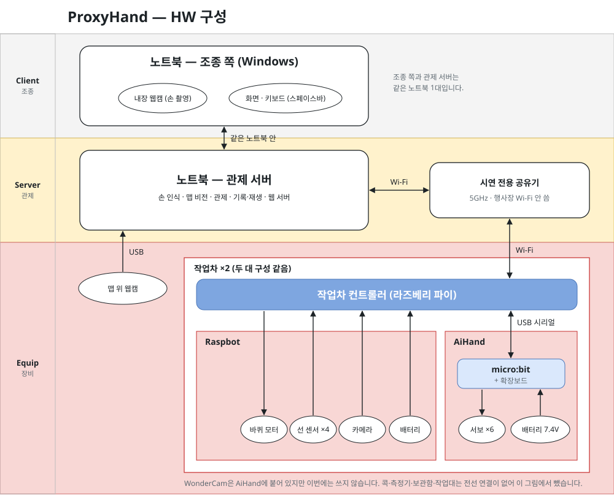
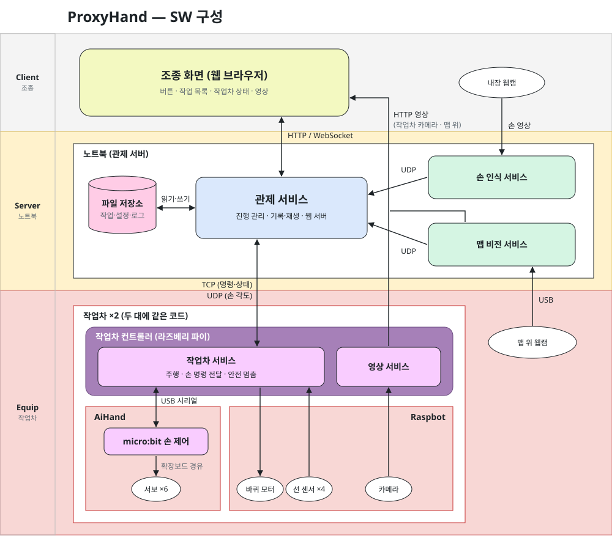
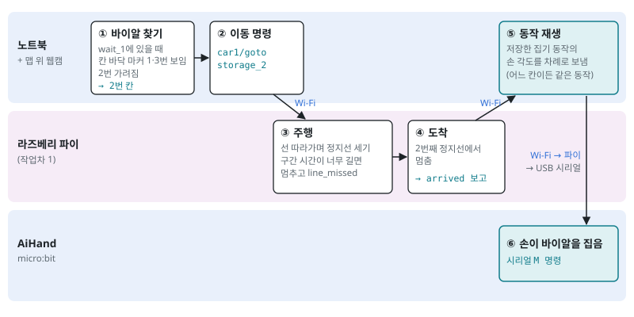

# ProxyHand 시스템 설계

* 작성일: 2026-11-17 (수정: 2026-11-19, 3.4 폴더 구조를 실제 저장소에 맞춤, 16장 담당자 이름 / 2026-11-19, 조종 화면에 손 영상 추가: 2.3, 3.1, 3.3, 9.2, 12장, 13장 / 2026-11-19, 12장 화면 배치 변경: 손 영상을 아래쪽 칸으로, 저장한 작업 칸 삭제 / 2026-11-19, 11장 `serial_fail` 복구를 [위치 지정] → [조종]으로)
* 기반 문서: ProxyHand 시스템 요구사항, ProxyHand 사용자 요구사항\_이보연, AiHand 기술조사\_이보연
* 함께 보는 문서: **ProxyHand 인터페이스 정의** (메시지, 오류 코드, 설정·데이터 파일 형식)
* 목적: 시스템 요구사항(SR)을 **어떻게** 만드는지 정리합니다. 팀원 2명과 Claude Code가 구현할 때 이 문서와 인터페이스 정의를 기준으로 합니다.
* 읽는 법: 그림은 이해를 돕기 위한 것이고, **구현 기준은 그림 아래의 표**입니다. 그림과 표가 다르면 표를 따릅니다. 두 사람의 코드가 똑같이 맞춰야 하는 것(메시지, 파일 형식)은 인터페이스 정의가 기준입니다.
* 상태: 1차 시험(AiHand 장착, 콕·버튼 동작, 맵 위 웹캠 인식) 결과에 따라 바뀔 수 있습니다(17장). "(잠정)"이라고 적은 숫자는 시험 후 확정합니다.

## 1. 주요 결정

| 항목 | 결정 | 이유 |
| --- | --- | --- |
| 처리 위치 | 무거운 계산(손 인식, 맵 위 영상 판단, 관제, 화면)은 노트북. 주행은 각 작업차의 라즈베리 파이. 서보 구동은 micro:bit | 노트북이 가장 빠름. 선 따라가기는 Wi-Fi 지연이 있으면 안 되므로 파이가 직접 함 |
| 층 나누기 | **Client**(조종 화면) / **Server**(노트북의 서비스들) / **Equip**(작업차 2대, 맵 위 웹캠) | 역할별로 나눠 큰 구성을 한눈에 보기 위함 |
| 프로그램 나누기 | **서비스 하나 = 따로 실행되는 Python 프로그램 하나.** 서비스끼리는 함수 호출이나 변수 공유 없이 인터페이스 정의에 적힌 메시지로만 주고받음 | 두 사람이 따로 개발하고, 가짜 메시지로 혼자 시험할 수 있음. 하나가 멈춰도 나머지는 동작 |
| Docker | **쓰지 않음** | Windows의 Docker는 리눅스 가상 머신 안에서 돌아 USB 웹캠 2대를 컨테이너에 넘기기 어렵고, 손 반응 시간이 늘어남. 파이도 시리얼·카메라·I2C 장치를 컨테이너에 열어 줘야 함. 3주·2명 일정에 맞지 않음. 서비스 단위로 나눠 두었으므로 나중에 옮기기는 쉬움 |
| 통신 | 노트북 ↔ 파이: Wi-Fi 위 UDP/TCP 메시지 (ROS 2 안 씀). 노트북 안 서비스끼리: 같은 컴퓨터 안 UDP(127.0.0.1). 파이 ↔ micro:bit: USB 시리얼 | 3주·2명 일정에서 설치·디버깅 부담이 가장 적음 |
| 메시지 이름 | ROS 2 토픽처럼 `car1/hand`, `vision/state` 식으로 지음 | 나중에 ROS 2로 옮기기 쉬움 |
| 언어 | 노트북·파이: Python 3. micro:bit: MicroPython (기술조사 때 만든 프로그램에 기능 추가). 조종 화면: HTML + JavaScript | 기술조사 코드 재사용 |
| 조종 화면 | 웹 화면 (관제 서비스가 웹 서버를 띄우고 브라우저로 봄) | 버튼, 목록, 작업차 2대 상태를 한 화면에 배치하기 쉬움 |
| 저장 | **DB 없이 파일**로 저장 (작업, 설정, 보정값, 로그) | 동시에 고치는 프로그램이 없고 검색도 필요 없음. 파일은 바로 열어 보고 git으로 관리 가능 |
| 맵 | 구역 2개(분주, 측정), 구역마다 한 방향 고리 1개, 작업대에서 바이알을 넘겨줌 | 두 작업차의 길이 겹치지 않아 관제가 작업대 하나로 끝남 |
| 바이알·작업대 판단 | 맵 위 웹캠이 **보관함 칸 바닥과 작업대 바닥의 ArUco 마커가 가려졌는지**로 판단 (가려짐 = 바이알 있음) | 마커를 칸 크기만큼 크게 만들 수 있어 멀리서도 잘 읽힘. 바이알마다 표식을 붙일 필요 없음 |
| 정거장 확인·위치 | **WonderCam과 카메라 위치 확인은 쓰지 않음.** 정지선 수로 정거장을 판단하고, 정지선을 놓쳤는지는 정거장 사이 주행 시간으로 확인. 정지 위치 오차는 감속과 물건 배치 조정으로 줄임 (5.3) | 로보카 위에 AiHand가 있어 작업차에 마커를 붙일 자리가 없음. 가장 단순함 |

## 2. 하드웨어 구성



*그림 3. 하드웨어 구성. Client·Server는 같은 노트북 1대입니다. 콕·측정기·보관함·작업대는 전선 연결이 없어 그림에서 뺐습니다(2.1 표에는 있음).*

### 2.1 장비

| ID | 장비 | 층 | 개수 | 놓는 곳 | 역할 | 비고 |
| --- | --- | --- | --- | --- | --- | --- |
| HW-01 | 노트북 (Windows) | Client + Server | 1 | 조종석 | 조종 화면, 손 촬영(내장 웹캠), 모든 노트북 서비스 실행 | 스페이스바 = 전체 정지 |
| HW-02 | 맵 위 웹캠 | Equip | 1 | 맵 가운데 위 (거치대) | 칸·작업대 바닥 마커, 콕 LED 촬영 | 노트북에 USB 연결. 1920×1080으로 사용 |
| HW-03 | 시연 전용 공유기 | Server | 1 | 조종석 근처 | 노트북·작업차 2대를 한 네트워크로 연결 | 5GHz 지원, 행사장 Wi-Fi 안 씀 |
| HW-04 | Raspbot (라즈베리 파이, 바퀴 모터, 바닥 선 센서 4개, 카메라, 배터리) | Equip | 2 | 맵 위 | 주행, 보조 영상 | 작업차 1·2. 라즈베리 파이 = 작업차 컨트롤러 |
| HW-05 | AiHand (micro:bit V2, 확장보드, 서보 6개) | Equip | 2 | Raspbot 위 (장착은 시험 후 결정) | 손 작업 | 손바닥이 차의 오른쪽을 보게 장착. 붙어 있는 WonderCam은 **이번에 안 씀** |
| HW-06 | AiHand용 7.4V 배터리 | Equip | 2 | 작업차 위 | 서보 전원 | 확장보드 DC 단자 |
| HW-07 | ArUco 마커 인쇄물 (`DICT_4X4_50`) | — | 4 | 보관함 칸 바닥 3, 작업대 바닥 1 | 맵 위 웹캠 판단용 | 무광 용지. ID와 크기는 5.2. 작업차에는 붙이지 않음 (AiHand 때문에 자리 없음) |
| HW-08 | 콕 + 열림 스위치 + LED | — | 1 | 작업차 1 길 위 다리 | 돌리기 대상. LED 켜짐 = 약을 담았다고 봄 | 손잡이에 연장판. LED는 다리 윗면에 위를 보게 붙임 |
| HW-09 | 측정기 (투입구 + 수거함 + 버튼 + LED) | — | 1 | 측정 구역 바깥쪽 | 바이알 넣기, 누르기 대상 | 투입구는 바이알보다 조금 큰 구멍, 아래에 수거함 상자 |
| HW-10 | 보관함 (3칸), 작업대 받침 | — | 각 1 | 분주 구역 바깥쪽, 두 구역 사이 | 바이알 받침 | **보관함 칸과 작업대 받침 모두 평평한 바닥 + 낮은 테두리.** 바닥 가운데에 마커를 붙여 바이알을 놓으면 가려지게 함. 위치는 1차 시험에서 작업차가 실제로 멈추는 자리에 맞춰 조정 (5.3) |

### 2.2 연결

| 출발 | 도착 | 연결 | 주고받는 것 |
| --- | --- | --- | --- |
| 노트북 | 공유기 | Wi-Fi | 작업차와의 모든 메시지 |
| 공유기 | 작업차 1·2 파이 | Wi-Fi | 손 각도, 이동 명령, 상태 보고, 영상 |
| 노트북 내장 웹캠 | 노트북 | 내부 | 조종자 손 영상 |
| 맵 위 웹캠 | 노트북 | USB 선 | 맵 영상 |
| 파이 | Raspbot 바퀴 모터·선 센서 | Raspbot 기본 연결 (Yahboom 라이브러리로 사용) | 바퀴 속도, 선 센서 값 |
| 파이 | Raspbot 카메라 | Raspbot 기본 연결 | 보조 영상 |
| 파이 | micro:bit | USB 선 | 서보 명령 (115200bps 시리얼) |
| micro:bit | 확장보드 | 보드끼리 연결된 핀 (UART P12/P8) | 서보 신호 |

### 2.3 카메라

| 카메라 | 연결된 곳 | 보는 것 | 쓰는 곳 |
| --- | --- | --- | --- |
| 노트북 내장 웹캠 | 노트북 | 조종자의 손 | 손 따라 하기 (SR-01), 화면의 손 영상 (SR-32) |
| 맵 위 웹캠 | 노트북 | 칸·작업대 바닥 마커, 콕 LED | 바이알 칸 찾기 (SR-23), 작업대 상태 (SR-28), 화면의 맵 위 영상 (SR-32) |
| Raspbot 카메라 | 파이 | 손 주변 | 조종 화면 보조 영상 (SR-32) |
| WonderCam | micro:bit | — | **이번에 안 씀** |

### 2.4 AiHand 서보

기술조사에서 한 대를 잰 값입니다. 보정 파일은 AiHand마다 따로 두지만(SR-03), **처음부터 다시 잴 필요는 없습니다.**

**보정 방법 (AiHand 한 대에 10분 정도)**

1. 보정할 AiHand의 micro:bit를 파이에서 빼서 **노트북 USB에 바로 꽂습니다.** 보정 도구(`laptop/tools/aihand_calib.py`)는 기술조사의 `serial_link.py`로 `S` 명령을 보냅니다.
2. `aihand_A.json`(아래 값)을 복사해 `aihand_B.json`을 만듭니다.
3. 서보마다 편 각도와 쥔 각도를 한 번씩 보내 봅니다. 서보가 끝에 걸려 "지잉" 소리가 나거나 손가락이 덜 닫히면 그 서보만 몇 도씩 고쳐 저장합니다.
4. 같은 방법으로 주행 자세의 손목 각도(9.5)를 정해 저장합니다.
5. micro:bit를 다시 파이에 꽂습니다.

같은 모델이라도 서보 축에 손가락 부품을 끼운 톱니 위치나 줄의 조임이 조금씩 달라, 같은 각도에서 손가락 위치가 몇 도씩 다를 수 있습니다. 그래서 확인은 꼭 합니다(SR-03, SR-04).

| 서보 | 부위 | 편 각도 | 쥔 각도 | 비고 |
| --- | --- | --- | --- | --- |
| 1 | 엄지 | 0° | 155° | 다른 손가락과 반대 방향 |
| 2 | 검지 | 150° | 32° | |
| 3 | 중지 | 150° | 31° | |
| 4 | 약지 | 150° | 30° | |
| 5 | 새끼 | 150° | 10° | |
| 6 | 손목 회전 | 0~180° | — | 0°에서 손바닥이 왼쪽, 180°에서 오른쪽 |

* 반복 동작은 측정값에서 5° 안쪽으로 씁니다(과열 방지).
* PWM 서보라 현재 위치를 알려 주지 않습니다. 도달 여부는 확인할 수 없습니다.

## 3. 소프트웨어 구성



*그림 4. 소프트웨어 구성. 상자 하나가 따로 실행되는 프로그램(서비스) 하나입니다.*

### 3.1 서비스 목록

| 서비스 | 층 | 실행 기계 | 시작 파일 | 하는 일 | 입력 | 출력 | 관련 SR |
| --- | --- | --- | --- | --- | --- | --- | --- |
| 조종 화면 | Client | 노트북 브라우저 | `laptop/control_service/web/index.html` (관제 서비스가 제공) | 상태 표시, 버튼·스페이스바 입력 | `ui/state`, `ui/alert`, 영상 3종(작업차 카메라, 맵 위, 손) | `ui/cmd` | SR-31~35, SR-40 |
| 손 인식 서비스 | Server | 노트북 | `laptop/hand_service/main.py` | 손 관절 점 21개 → 손가락 굽힘 정도(0~1), 손목 회전 각도. 손 영상 제공 | 내장 웹캠, `hand/calib`, `laptop.yaml` | `hand/pose`, 손 영상(HTTP) | SR-01, SR-09, SR-32 |
| 맵 비전 서비스 | Server | 노트북 | `laptop/vision_service/main.py` | 마커 찾기 → 칸·작업대 마커가 가려졌는지, 콕 LED 켜짐. 맵 위 영상 제공 | 맵 위 웹캠, `topcam.json` | `vision/state`, 맵 위 영상(HTTP) | SR-23, SR-25, SR-28, SR-32 |
| 관제 서비스 | Server | 노트북 | `laptop/control_service/main.py` | 진행 관리(모드, 작업대 상태, 혼자 하기), 자세 변환(손 → 서보 각도), 기록·재생, 웹 서버, 로그 | `hand/pose`, `vision/state`, 파이 메시지, `ui/cmd`, 파일 | 파이 명령, `ui/state`, `ui/alert`, 파일 | SR-02~04, SR-07, SR-08, SR-18~22, SR-24, SR-27~40 |
| 작업차 서비스 | Equip | 각 파이 | `pi/car_service/main.py` | 선 따라가기, 정지선 세기, 정지선 놓침 확인(구간 시간), 손 명령 전달, 안전 멈춤 | 파이 명령, 선 센서, micro:bit 응답 | 바퀴 구동, 시리얼 명령, 파이 보고 | SR-05, SR-08, SR-10~13, SR-36, SR-38 |
| 영상 서비스 | Equip | 각 파이 | `pi/video_service/main.py` | Raspbot 카메라 영상 제공 | Raspbot 카메라 | MJPEG 영상(HTTP) | SR-32 |
| micro:bit 손 제어 | Equip | micro:bit | `microbit/main.py` | 시리얼 명령 → 확장보드 서보 신호 | 시리얼 명령 | 서보 구동, 응답 | SR-02, SR-05 |

예전 문서의 프로그램 번호(①~⑪)는 이렇게 옮겨졌습니다.

| 예전 | 지금 |
| --- | --- |
| ① 손 인식 | 손 인식 서비스 |
| ② 자세 변환 | 손 인식 서비스(굽힘 정도 계산) + 관제 서비스(작업차별 보정값으로 서보 각도로 바꿈) |
| ③ 위치 찾기 | 맵 비전 서비스 |
| ④ 기록·재생, ⑤ 진행 관리 | 관제 서비스 |
| ⑥ 웹 조종 화면 | 관제 서비스(웹 서버) + 조종 화면 |
| ⑦ 주행, ⑧ 손 명령 전달, ⑩ 안전 멈춤 | 작업차 서비스 |
| ⑨ 영상 보내기 | 영상 서비스 |
| ⑪ micro:bit 중계 | micro:bit 손 제어 |

### 3.2 서비스 사이 연결

메시지 내용과 포트 번호는 인터페이스 정의가 기준입니다.

| 출발 | 도착 | 방식 | 메시지 |
| --- | --- | --- | --- |
| 조종 화면 | 관제 서비스 | WebSocket (`ws://localhost:8000/ws`) | `ui/cmd` |
| 관제 서비스 | 조종 화면 | WebSocket | `ui/state`, `ui/alert` |
| 손 인식 서비스 | 관제 서비스 | UDP 127.0.0.1 | `hand/pose` |
| 관제 서비스 | 손 인식 서비스 | UDP 127.0.0.1 | `hand/calib` |
| 맵 비전 서비스 | 관제 서비스 | UDP 127.0.0.1 | `vision/state` |
| 맵 비전 서비스 | 조종 화면 | HTTP MJPEG | 맵 위 영상 |
| 손 인식 서비스 | 조종 화면 | HTTP MJPEG | 손 영상 (거울 화면 + 관절 점) |
| 관제 서비스 | 작업차 서비스 | UDP | `car{n}/hand` |
| 관제 서비스 ↔ 작업차 서비스 | | TCP (관제가 접속) | 명령(`goto`, `stop` 등), 보고(`status`, `arrived` 등) |
| 영상 서비스 | 조종 화면 | HTTP MJPEG | 작업차 카메라 영상 |
| 작업차 서비스 | micro:bit 손 제어 | USB 시리얼 | `P`, `M` 명령 |
| 관제 서비스 | 파일 저장소 | 파일 읽기·쓰기 | 작업, 설정, 보정값, 로그 |

* 손 각도는 손 인식 서비스에서 파이로 바로 가지 않고 **관제 서비스를 거칩니다.** 그래야 "이 작업차에 손 명령을 보내도 되는지" 검사(SR-07, SR-08), 작업차별 보정값 적용(SR-03), 가르치기 기록(SR-18)을 한곳에서 할 수 있습니다. 같은 노트북 안이라 거치는 시간은 1ms보다 짧습니다.

### 3.3 쓸 도구 (제안)

구현하면서 바꿀 수 있습니다. 바꾸면 이 표를 고칩니다.

| 용도 | 도구 | 비고 |
| --- | --- | --- |
| 손 인식 | MediaPipe Hands (Python) | 손 관절 점 21개 |
| 마커 인식 | OpenCV `cv2.aruco`, 사전 `DICT_4X4_50` | `minMarkerPerimeterRate`를 0.01 정도로 낮춤 (5.2) |
| 웹 서버 | FastAPI + uvicorn + WebSocket | 상태는 WebSocket으로 실시간 갱신 |
| 조종 화면 | HTML + JavaScript (빌드 도구 없이 파일 그대로) | 영상은 `` |
| 시리얼 통신 | pyserial | 기술조사의 `serial_link.py` 재사용 |
| 주행 | Yahboom이 Raspbot에 제공하는 Python 라이브러리 | 모터, 선 센서 |
| 영상 (파이, 노트북) | OpenCV + 간단한 HTTP 서버 (MJPEG) | 파이는 Raspbot 기본 스트리밍을 써도 됨 |
| 설정 파일 | PyYAML | 사람이 고치는 설정은 YAML, 프로그램이 저장하는 것은 JSON (인터페이스 정의 9장) |

### 3.4 폴더 구조

```
proxy-hand/                (git 저장소)
├─ README.md               폴더 설명, 실행 방법, 아직 정할 값 목록
├─ .gitignore              .venv, __pycache__, data/logs/ 안의 내용 제외
├─ CLAUDE.md               Claude Code용 공통 규칙 (laptop/, pi/, microbit/에도 폴더별 CLAUDE.md)
├─ docs/                   기준 문서 5개 + 그림. 문서는 여기서만 고침 (Confluence는 확정본 사본)
├─ laptop/
│  ├─ hand_service/        손 인식 서비스
│  ├─ vision_service/      맵 비전 서비스
│  ├─ control_service/     관제 서비스 (진행 관리, 자세 변환, 기록·재생, 웹 서버, 로그)
│  │  └─ web/              조종 화면 (HTML, JS, CSS)
│  ├─ tools/               보정 도구: AiHand 보정(aihand_calib.py, micro:bit를 노트북에 직접 연결), 맵 위 웹캠 보정(topcam_calib.py, 웹캠 번호·콕 LED 영역 지정)
│  ├─ config/laptop.yaml   노트북에만 있는 설정 (손 인식 웹캠 번호, 인식할 손)
│  ├─ requirements.txt     노트북 Python 패키지 목록
│  └─ start_laptop.bat     노트북 서비스 3개를 한 번에 실행
├─ pi/
│  ├─ car_service/         작업차 서비스
│  ├─ video_service/       영상 서비스
│  ├─ config/car.yaml      작업차마다 다른 설정 (작업차 번호, 속도 등)
│  ├─ requirements.txt     파이 Python 패키지 목록
│  └─ systemd/             부팅 때 자동 실행 설정 (proxyhand-car.service, proxyhand-video.service)
├─ microbit/               micro:bit 손 제어 (main.py)
├─ shared/                 노트북·파이 공통
│  ├─ config/network.yaml  IP, 포트, 시간 설정
│  ├─ config/map.yaml      정거장, 마커, 판단 기준값
│  ├─ config.py            설정 읽기 + 검사
│  └─ messages.py          메시지 이름·필드 상수, 보내기·받기 함수
└─ data/                   노트북에만 있음 (파일 저장소)
   ├─ calibration/         aihand_A.json, aihand_B.json, topcam.json, operator.json
   ├─ tasks/               저장한 작업
   └─ logs/                실행마다 폴더 하나 (git에 올리지 않음)
```

* 두 파이는 같은 코드를 쓰고 `pi/config/car.yaml`의 작업차 번호(1 또는 2)만 다릅니다.
* `shared/`는 노트북과 파이에 같은 내용으로 복사합니다(git으로 받음).
* `laptop/`, `pi/`와 그 안의 서비스 폴더마다 빈 `__init__.py`를 둡니다. 서비스가 `shared/`를 불러올 수 있게 하기 위함입니다.
* 모든 서비스는 **저장소 맨 위 폴더에서** `python -m <폴더>.<서비스>.main`으로 실행합니다. 예: `python -m laptop.hand_service.main`, `python -m pi.car_service.main`. 서비스 폴더 안에서 `python main.py`로 실행하면 `shared/`를 찾지 못합니다.
* `shared/config.py`(파일)와 `shared/config/`(설정 파일 폴더)는 이름이 같지만, `import shared.config`는 `config.py`를 불러옵니다(폴더에 `__init__.py`가 없기 때문). 이 폴더에는 `__init__.py`를 넣지 않습니다.

### 3.5 실행 방식

| 기계 | 방법 |
| --- | --- |
| 노트북 | `start_laptop.bat`이 `hand_service`, `vision_service`, `control_service`를 각각 창 하나씩 띄움. 브라우저로 `http://localhost:8000` 접속 |
| 파이 | systemd 서비스 2개(`proxyhand-car`, `proxyhand-video`)로 부팅 때 자동 실행. 죽으면 자동 재시작. 서비스 파일의 사용자 이름(`User=pi`)과 저장소 위치(`/home/pi/proxy-hand`)는 임시 값이라, 실제 파이에 맞게 고친 뒤 설치 |
| micro:bit | 프로그램을 한 번 올려 두면 전원이 들어올 때 자동 실행 |

* 각 서비스는 시작할 때 설정을 읽고, 필드가 빠졌거나 범위를 벗어나면 **바로 오류를 내고 멈춥니다**(시연 중에 설정 실수가 드러나지 않게).
* 각 서비스는 다른 서비스 없이도 실행됩니다. 예: 관제 서비스는 손 인식 서비스가 꺼져 있어도 뜨고, 화면에 "손 인식 서비스 꺼짐"을 표시합니다.

### 3.6 개발 환경

| 기계 | OS | Python | 설치할 것 | 비고 |
| --- | --- | --- | --- | --- |
| 노트북 | Windows 11 | **3.11 (64비트)** | `laptop/requirements.txt`: mediapipe, opencv-contrib-python, numpy, fastapi, uvicorn[standard], pyyaml, pyserial | MediaPipe가 지원하는 버전 범위 안에서 고름. 가상 환경(`venv`) 하나를 만들어 씀 |
| 파이 (2대) | Raspbot 기본 이미지의 Raspberry Pi OS 그대로 | 이미지 기본 Python 3 | `pi/requirements.txt`: pyserial, pyyaml, opencv-python-headless(영상 서비스. 화면 창을 띄우는 기능을 뺀 가벼운 버전) | Yahboom 라이브러리가 시스템 Python에 깔려 있으므로, 가상 환경은 `python3 -m venv --system-site-packages`로 만들어 그 라이브러리를 같이 씀 |
| micro:bit | — | MicroPython (기술조사 때 쓴 버전) | `microbit/main.py` | 기술조사 프로그램에 `M` 명령 추가 |

| 항목 | 방법 |
| --- | --- |
| 코드 관리 | git 저장소 하나. 노트북에서 개발하고 push |
| 파이에 올리기 | 파이에서 `git pull` → `sudo systemctl restart proxyhand-car proxyhand-video` |
| 웹캠 번호 | 노트북에 웹캠이 2대(내장, 맵 위)라 번호가 바뀔 수 있음. 손 인식용은 `laptop/config/laptop.yaml`의 `hand_camera_index`, 맵 위용은 `topcam.json`의 `camera_index`. 시작할 때 조종 화면의 손 영상과 맵 위 영상으로 번호가 맞는지 눈으로 확인 |
| 시계 맞추기 | 시연 공유기에 인터넷이 없으면 파이 시계가 틀어짐. 관제가 파이에 접속할 때마다 `car{n}/time_sync`로 노트북 시각을 보내고, 파이는 그 차이만큼 더한 시각을 메시지의 `t`와 로그에 씀 (파이의 시스템 시계는 바꾸지 않음) |

## 4. 통신 (요약)

메시지 하나하나의 필드, 예시, 받는 조건은 **인터페이스 정의**에 있습니다. 여기는 큰 흐름만 둡니다.

| 구간 | 방식 | 왜 |
| --- | --- | --- |
| 손 각도 (관제 → 파이) | UDP, 1초 15~30번 | 보낸 뒤 도착 확인을 하지 않아 빠름. 하나 빠져도 바로 다음 값이 옴 |
| 명령·보고 (관제 ↔ 파이) | TCP, JSON 한 줄씩 | 순서대로 빠짐없이 도착해야 함 (이동, 정지 등) |
| 생존 신호 (관제 → 파이) | TCP, 0.2초마다 | 1초 넘게 안 오면 파이가 스스로 멈춤 (SR-38) |
| 노트북 안 서비스끼리 | UDP 127.0.0.1 | 같은 컴퓨터 안이라 빠지는 일이 거의 없음 |
| 화면 (관제 ↔ 브라우저) | WebSocket | 상태를 서버에서 화면으로 바로 밀어 줌 |
| 영상 | HTTP MJPEG | 브라우저가 ``로 바로 표시 |
| 파이 ↔ micro:bit | USB 시리얼 115200bps, 한 줄씩 | 기술조사 코드 재사용 |

**파이가 손 명령을 받는 조건 (SR-08):** 파이는 상태가 `arrived`일 때만 `car{n}/hand`를 micro:bit로 넘깁니다. 관제도 같은 조건으로 보내지 않지만, 파이에서 한 번 더 막습니다.

## 5. 맵 데이터

맵 정보는 `shared/config/map.yaml`에 두고 노트북과 파이가 같이 읽습니다. 콕 LED 영역처럼 맵 위 웹캠 사진에서 재서 정하는 값은 `data/calibration/topcam.json`에 둡니다(형식은 인터페이스 정의 9장).

### 5.1 정거장

정지선 번호는 **대기 정거장에서 출발해 몇 번째 정지선인지**입니다. 작업차는 고리를 한 방향으로만 돌기 때문에, 지금 정거장에서 목표 정거장까지 넘어야 할 정지선 수는 `(목표 번호 − 지금 번호)`를 고리의 정지선 수로 나눈 나머지입니다.

| 정거장 ID | 이름 | 구역 | 정지선 번호 | 하는 일 |
| --- | --- | --- | --- | --- |
| `wait_1` | 대기 1 | 분주 (고리 정지선 6개) | 0 (= 6) | 작업차 1 출발·대기 |
| `storage_1` | 보관함 1번 칸 | 분주 | 1 | 바이알 집기 |
| `storage_2` | 보관함 2번 칸 | 분주 | 2 | 바이알 집기 |
| `storage_3` | 보관함 3번 칸 | 분주 | 3 | 바이알 집기 |
| `bench_1` | 작업대 (작업차 1 쪽) | 분주 | 4 | 바이알 놓기 |
| `cock` | 콕 | 분주 | 5 | 콕 열고 닫기 |
| `wait_2` | 대기 2 | 측정 (고리 정지선 3개) | 0 (= 3) | 작업차 2 출발·대기 |
| `bench_2` | 작업대 (작업차 2 쪽) | 측정 | 1 | 바이알 집기 |
| `meter` | 측정기 | 측정 | 2 | 투입구에 바이알 넣기(수거함으로 떨어짐), 시작 버튼 누르기 |

* `storage_*`는 저장한 작업 안에서 "**바이알이 있는 칸**"을 뜻합니다(SR-20). 재생할 때 맵 비전 결과로 `storage_1~3` 중 하나로 바뀝니다.

### 5.2 맵 위 웹캠 마커와 판단 규칙

**마커** (사전 `DICT_4X4_50`, 무광 용지). 작업차에는 붙이지 않습니다(로보카 위에 AiHand가 있어 자리가 없음).

| 대상 | 마커 ID | 크기 (잠정) | 붙이는 곳 |
| --- | --- | --- | --- |
| 보관함 1·2·3번 칸 | 1, 2, 3 | 한 변 40mm | 칸 바닥 가운데. 바이알을 놓으면 가려지는 자리 |
| 작업대 | 4 | 한 변 40mm | 작업대 받침 바닥 가운데. 같은 방식 |

**마커 크기 정하는 법:** 사진 속 마커 한 변이 **25픽셀 이상**이면 안정적으로 읽힙니다(4×4 마커는 테두리 포함 한 변 6칸, 칸 하나에 4픽셀 이상).

```
마커 한 변(mm) ≥ 25 ÷ (1920 ÷ 웹캠이 보는 맵 가로 길이(mm))
예) 바닥판 가로 1.2m → 1mm당 1.6픽셀 → 16mm 이상. 마커 40mm면 64픽셀로 넉넉함
```

* OpenCV는 기본 설정에서 사진 가로의 3%보다 둘레가 작은 마커를 버립니다. `minMarkerPerimeterRate`를 0.01 정도로 낮춥니다.
* 웹캠은 1920×1080으로 쓰고, 맵 전체가 겨우 들어오는 높이까지 내립니다.

**콕 LED 영역:** LED를 둘러싼 작은 사각형 영역을 보정 도구로 한 번 지정합니다. LED를 켠 때와 끈 때의 평균 밝기를 재서 그 중간값을 "켜짐 기준 밝기"로 `topcam.json`에 저장합니다.

**판단은 두 단계로 나눕니다.**

| 단계 | 누가 | 하는 일 |
| --- | --- | --- |
| 1. 마커가 가려졌나 | 맵 비전 서비스 | 마커마다 "가려짐(있음)" / "보임(없음)"을 판단해 `vision/state`로 보냄. 작업차가 어디 있는지는 모름 |
| 2. 그 판단을 믿어도 되나 (보류) | 관제 서비스 | 파이 보고로 각 작업차가 어디 있는지 알고 있으므로, 작업차의 AiHand가 마커를 가렸을 수 있는 때는 "보류"로 바꿈 |

**1단계 규칙 (맵 비전, SR-23, SR-28)**

| 상황 | 판단 |
| --- | --- |
| 마커가 0.5초(잠정) 넘게 계속 안 보임 | 바이알 **있음** |
| 마커가 0.5초 넘게 계속 보임 | 바이알 **없음** |
| 콕 LED 영역의 평균 밝기가 켜짐 기준보다 높은 상태가 0.3초 이상 이어짐 | 콕 LED 켜짐 (잠깐 반사된 빛을 켜짐으로 오해하지 않기 위함) |

**2단계 규칙 (관제, 보류)** — 작업차의 AiHand 손이 마커를 가렸을 수 있는 때는 1단계 결과를 쓰지 않고 "보류"(`unknown`)로 둡니다.

| 판단 대상 | 보류하는 때 |
| --- | --- |
| 보관함 칸 k | 작업차 1이 **움직이는 중**(`driving`)이거나, `storage_k`에 서 있거나, 정거장 사이에서 멈춤(`stopped`, 정거장 모름) |
| 작업대 | 작업차 1이 움직이는 중이거나 `bench_1`에 서 있음, **또는** 작업차 2가 움직이는 중이거나 `bench_2`에 서 있음, 또는 둘 중 하나가 정거장 사이에서 멈춤 |

* 보류가 풀린 뒤 1단계 결과가 0.5초 동안 그대로여야 그 값을 씁니다(보류가 풀리는 순간의 흔들림 방지).
* 맵을 만들 때, 다른 정거장(예: `cock`, `storage_3`)에 선 AiHand가 작업대나 다른 칸의 마커를 가리지 않게 배치합니다. 가리면 이 규칙으로는 걸러지지 않습니다(17장).

**칸 고르기 (관제, SR-22, SR-25)**

| 상황 | 판단 |
| --- | --- |
| 여러 칸에 바이알이 있음 | 번호가 가장 작은 칸부터 가져감 |
| 어느 칸에도 없음 (혼자 하기 시작할 때) | 시작하지 않고 "바이알을 찾지 못함" 알림 (SR-25) |
| 어느 칸에도 없음 (반복 중) | 보관함이 빈 것으로 보고 반복 정상 종료, "보관함 비었음" 알림 (SR-22) |
| 칸이 하나라도 보류 | 판단을 미루고 0.2초 뒤 다시 봄. 작업차 1은 `wait_1`에 서 있을 때 칸을 고르므로 보통 보류가 없음 |

* **약점:** 사람 손이 마커를 가려도 "있음"으로 봅니다. 시연 중에 사람이 보관함·작업대에 손을 대지 않습니다. 바이알이 넘어져 마커 일부만 가려도 "있음"이 될 수 있습니다(ArUco는 네 모서리가 다 보여야 인식됨). 이때는 집기에 실패하고, 조종자가 정지 후 조종으로 처리합니다.

### 5.3 정거장 확인과 정지 위치 (SR-12~14)

작업차에 마커를 붙일 수 없으므로 카메라로 작업차 위치를 재지 않습니다. 대신 아래 세 가지로 맞춥니다.

| 무엇을 | 방법 |
| --- | --- |
| 맞는 정거장인지 | 파이가 센 **정지선 수**로 판단 (10.2) |
| 정지선을 놓쳤는지 | **구간 시간 확인.** 정지선 사이를 가는 데 걸린 시간이 1차 시험에서 잰 시간보다 크게 길면(보통 속도 구간 1.5배, 느린 속도 구간 3배, 잠정) 정지선을 놓친 것으로 보고 멈춤 + `line_missed` (10.3) |
| 정지 위치 오차 (앞뒤) | ① 목표 정지선 앞 구간은 느린 속도로 와서 미끄러짐을 줄임. ② 1차 시험에서 정거장마다 10번씩 멈춰 **실제로 멈추는 자리**를 재고, 보관함 칸·작업대·콕·측정기를 그 자리에 맞춰 놓음(정지선을 옮기는 것보다 물건을 옮기는 게 쉬움). ③ 콕 손잡이 연장판처럼 AiHand가 잡는 부분을 넓게 만들어 오차를 받아 줌 |

* 작업차는 선 위를 달리므로 좌우는 선이 잡아 줍니다. 남는 오차는 앞뒤뿐입니다.
* 중요한 건 정지선과의 거리보다 **매번 같은 자리에 서는지**(반복 오차)입니다. 반복 오차가 ±1cm(SR-12) 안이면 물건을 그 자리에 맞춰 두면 됩니다.
* 길을 가로막는 멈춤 턱은 쓰지 않습니다. 고리를 한 방향으로 계속 돌아야 하는데 턱이 길을 막기 때문입니다.

## 6. 모드와 상태

### 6.1 작업차 모드 (관제 서비스가 관리)

작업차마다 모드가 따로 있습니다. 코드에서 쓰는 이름은 괄호 안입니다.

| 지금 모드 | 무슨 일이 생기면 | 다음 모드 | 비고 |
| --- | --- | --- | --- |
| 대기 (`idle`) | [조종] | 조종 | |
| 대기 | [가르치기] | 가르치기 | 기록 시작 |
| 대기 | 작업 고르고 [시작] | 혼자 하기 | **파이가 대기 정거장(`wait_1`/`wait_2`)에서 `arrived`일 때만.** 아니면 [시작]을 막음 (SR-22) |
| 조종 (`manual`) | [가르치기] | 가르치기 | 기록 시작 |
| 조종 | [대기] | 대기 | |
| 가르치기 (`teach`) | [기록 끝] + 작업 이름 | 조종 | 작업 파일 저장 (SR-18) |
| 혼자 하기 (`auto`) | 작업 끝, [반복] 꺼짐 | 대기 | |
| 혼자 하기 | 작업 끝, [반복] 켜짐 | 혼자 하기 | 처음 단계부터 다시 |
| 혼자 하기 | [반복] 중 보관함이 빔 (작업차 1) / 작업차 1의 반복이 끝나고 작업대가 빔 (작업차 2) | 대기 | 정상 종료, "보관함 비었음" 알림 |
| 모든 모드 | 작업차별 [정지], 스페이스바, 11장의 "정지" 오류 | 정지 | 관제가 `stop`을 보냄. 바퀴 멈춤, 손 자세 유지 (SR-35, SR-36) |
| 정지 (`stopped`) | [조종] | 조종 | 관제가 `resume`을 보냄. 손으로 하던 일을 마무리 (SR-37). **정지에서 갈 수 있는 모드는 조종뿐** |

* 정지에서 혼자 하기로 바로 갈 수 없습니다. 바이알을 쥔 채 멈췄을 때 혼자 하기가 이어지다 바이알을 놓치는 일을 막기 위해서입니다.
* 다시 혼자 하기를 하려면 정지 → [조종]으로 마무리 → 대기 정거장으로 이동 → [대기] → [시작] 순서를 거칩니다.
* [위치 지정]: 작업차를 손으로 어떤 정거장 위에 올려 둔 뒤 누릅니다. 모드는 바뀌지 않고, 관제가 `set_station`을 보냅니다. 대기·정지 모드에서만 됩니다(13장 시작 절차, 11장 선 놓침 복구).
* 손 명령은 **조종 대상으로 고른 작업차**가 **조종 또는 가르치기 모드**이고 파이가 **`arrived` 상태**일 때만 보냅니다 (SR-07, SR-08).

### 6.2 파이 상태 (각 작업차 서비스가 관리)

| 상태 | 뜻 | 손 명령 받음 |
| --- | --- | --- |
| `idle` | 켜졌고 아직 어느 정거장인지 모름 | 아니요 |
| `driving` | 정거장으로 가는 중 | 아니요 |
| `arrived` | 정거장에 서 있음 | 예 |
| `stopped` | 정지 명령 또는 신호 끊김으로 멈춤. 관제의 다음 명령이 올 때까지 움직이지 않음 | 아니요 |
| `error` | 선을 놓침, 정지선을 놓침, micro:bit 연결 오류 | 아니요 |

* 상태가 바뀌는 조건과 상태별로 받는 명령 표는 인터페이스 정의 4.4에 있습니다.
* `stopped`에서 `resume`을 받으면, 멈추기 직전이 `arrived`였고 그 뒤로 움직이지 않았으면 `arrived`로 돌아갑니다. 아니면 `stopped`에 머물고 `goto`만 받습니다(정거장 사이에서 멈췄으면 다음 정거장으로 보내야 함).

### 6.3 작업대 상태 (관제 서비스가 관리, SR-28)

바이알 안은 볼 수 없으므로, **바이알이 작업대에 있는 상태에서 콕 LED가 켜지면 약이 담겼다고 봅니다.** 판단은 모두 맵 비전 결과로 하고, 새 부품은 쓰지 않습니다. 작업대 바이알이 "보류"일 때는 상태를 바꾸지 않습니다.

**처음 상태:** 관제를 켜면 첫 `vision/state`로 정합니다. 작업대에 바이알이 없으면 "비어 있음"으로 시작합니다. 바이알이 있으면 "비어 있음"으로 두고 "작업대에 바이알이 남아 있음" 경고(`bench_not_empty`)를 띄웁니다. 조종자가 바이알을 치우면 경고가 사라집니다(시연 준비 상태는 작업대가 비어 있어야 함).

| 지금 상태 | 무슨 일이 생기면 (맵 비전) | 다음 상태 |
| --- | --- | --- |
| 비어 있음 (`empty`) | 작업대 바이알 있음, 콕 LED 꺼짐 | 담는 중 |
| 비어 있음 | 작업대 바이알 있음, 콕 LED가 이미 켜짐 | 비어 있음 유지 + "콕이 열려 있음" 경고(`cock_open`), 작업차 1 정지 |
| 담는 중 (`filling`) | 콕 LED 켜짐 | 담기 끝 |
| 담기 끝 (`filled`) | 작업대 바이알 없음 | 비어 있음 |

* **"담기 끝"은 기억해 둡니다.** "담는 중"일 때 LED가 한 번이라도 켜지면 "담기 끝"으로 바꿔 저장합니다. 그 뒤 콕을 닫아 LED가 꺼져도 그대로이고, 작업대에서 바이알이 없어져야 "비어 있음"으로 바뀝니다.
* **보류 중에 LED가 켜진 경우:** 작업대는 작업차 1·2 중 하나라도 움직이는 동안 보류입니다(5.2). 그래서 작업차 1이 콕을 여는 순간에 작업차 2가 움직이고 있으면, 작업대가 아직 "비어 있음"인 채로 LED가 켜졌다 꺼질 수 있습니다. 이를 놓치지 않게, 작업대가 "비어 있음"에서 보류에 들어갈 때 **그 순간 LED가 켜져 있었는지**와 **보류 중에 LED가 켜진 적이 있는지**를 기억해 둡니다. 보류가 풀려 바이알 "있음"이 되면: 보류 시작 때 꺼져 있었고 보류 중에 켜진 적이 있으면 바로 "담기 끝", 보류 시작 때 이미 켜져 있었으면 `cock_open` 경고, 둘 다 아니면 "담는 중".
* 작업차 1은 콕을 연 채로 1초 이상(잠정) 멈췄다가 닫습니다. LED가 0.3초 이상 켜져 있어야 켜짐으로 판단하기 때문입니다.
* 작업차 1은 콕을 연 뒤 반드시 다시 닫습니다(SR-16). 닫지 않으면 다음 바이알이 놓이자마자 `cock_open` 경고가 납니다.
* 작업차 2는 "담기 끝"이 되면 바로 출발할 수 있습니다. 두 길이 겹치지 않아 작업차 1이 콕을 닫는 동안 가도 문제없습니다.
* **대체 방법:** 1차 시험에서 맵 위 웹캠이 콕 LED를 잘 알아보지 못하면, "작업차 1이 `cock`에서 손 동작 재생을 끝냄"을 담기 끝 조건으로 씁니다. 손이 콕을 덜 돌려도 담기 끝이 되는 약점이 있습니다.

## 7. 작업 흐름

### 7.1 바이알 위치가 바뀌었을 때 (작업차 1, 혼자 하기)



*그림 2. 바이알 위치가 바뀌었을 때 노트북, 파이, AiHand가 차례로 하는 일.*

| 단계 | 누가 | 무엇을 | 메시지 |
| --- | --- | --- | --- |
| 1 | 맵 비전 + 관제 | 작업차 1이 `wait_1`에 서 있을 때, 칸 바닥 마커 중 가려진 칸을 찾음 (예: 1·3번 보임, 2번 가려짐 → 2번 칸) | `vision/state` |
| 2 | 관제 | 저장한 작업의 `storage_*`를 `storage_2`로 바꿔 이동 지시 | `car1/goto {station: storage_2}` |
| 3 | 작업차 서비스 | 선을 따라가며 정지선을 셈. 정지선 사이 시간이 너무 길면 멈추고 `line_missed` (5.3) | `car1/status {state: driving}` |
| 4 | 작업차 서비스 | 2번째 정지선에서 멈추고 도착 보고 | `car1/arrived {station: storage_2}` |
| 5 | 관제 | 저장한 집기 동작의 손 각도를 기록된 시간 간격대로 보냄 | `car1/hand` 여러 번 |
| 6 | 작업차 서비스 → micro:bit | 각도를 서보로 전달, 손이 바이알을 집음 | 시리얼 `M` |
| 7 | 맵 비전 + 관제 | 작업차 1이 다음 정거장에 도착해 보류가 풀리면, 2번 칸 마커가 다시 보이는지 확인 | `vision/state` |

### 7.2 혼자 하기 한 사이클

**작업차 1 (분주)**

| 단계 | 하는 일 | 조건 |
| --- | --- | --- |
| 1 | `wait_1`에서 대기 | 작업대가 "비어 있음"이어야 시작 (SR-29) |
| 2 | 바이알이 있는 칸 찾기 | 첫 사이클에 못 찾으면 시작 안 함 (SR-25). 반복 중에 못 찾으면 보관함이 빈 것이므로 정상 종료 (SR-22) |
| 3 | `storage_k`로 이동 → 집기 동작 재생 | |
| 4 | `bench_1`로 이동 → 놓기 동작 재생 | 작업차 1이 다음 정거장에 도착해 보류가 풀리고 작업대 마커가 가려져 있으면 작업대 → 담는 중 |
| 5 | `cock`으로 이동 → 콕 열기 → 1초 유지 → 닫기 동작 재생 | 열 때 LED가 켜지면 작업대 → 담기 끝 |
| 6 | `wait_1`로 이동 | 반복이 켜져 있으면 1로 |

**작업차 2 (측정)**

| 단계 | 하는 일 | 조건 |
| --- | --- | --- |
| 1 | `wait_2`에서 대기 | 작업대가 "담기 끝"이어야 시작 (SR-29) |
| 2 | `bench_2`로 이동 → 집기 동작 재생 | 작업차 2가 다음 정거장에 도착해 보류가 풀리고 작업대 마커가 보이면 작업대 → 비어 있음 |
| 3 | `meter`로 이동 → 투입구에 넣기 + 버튼 누르기 동작 재생 | 바이알은 수거함으로 떨어져 투입구가 다시 빔 |
| 4 | `wait_2`로 이동 | 반복이 켜져 있으면 1로. 작업차 1의 반복이 끝났고 작업대가 비어 있으면 정상 종료 |

* **출발 조건은 작업차마다 설정으로 정합니다:** `map.yaml`의 `cars.<n>.start_when`. 작업차 1은 `bench_empty`(작업대 비어 있음), 작업차 2는 `bench_filled`(담기 끝). 관제는 혼자 하기의 매 반복을 시작하기 전에 이 조건을 봅니다.
* **기다리는 곳:** 조건이 안 되면 대기 정거장에서 기다립니다. 관제는 조건을 0.2초마다 다시 확인합니다.
* **반복 횟수:** 보관함의 바이알 3개를 다 쓰면 끝납니다(최대 3번). 시연 중에 사람이 바이알을 옮기지 않습니다. 다시 하려면 시연 준비 상태(보관함에 바이알 3개, 수거함 비우기, 콕 닫힘, 작업차는 대기 정거장)로 되돌립니다.
* **이동 시간 초과:** `goto` 후 30초(잠정) 안에 `arrived`가 오지 않으면 정지하고 `goto_timeout` 알림.

## 8. 가르치기와 재생 (SR-18~22)

작업 하나 = `data/tasks/` 안의 JSON 파일 하나입니다. 파일 형식은 인터페이스 정의 9.7에 있습니다.

* **기록:** 가르치기 중 관제가 보낸 `goto`와 `hand` 메시지를 그대로 단계로 쌓습니다. 정거장에 도착(`arrived`)한 뒤 다음 `goto`까지 보낸 `hand`가 한 `hand` 단계가 됩니다. 보관함 정거장은 `storage_*`로 저장합니다(SR-20).
* **재생:** `goto`를 보내고 `arrived`를 기다린 뒤, `hand` 단계의 프레임을 `dt` 간격대로 보냅니다. UDP라 하나가 빠질 수 있으므로, **각 `hand` 단계의 마지막 프레임은 0.1초 간격으로 3번** 보냅니다(마지막 자세, 예를 들어 쥔 손이 꼭 도착하게).
* 작업 파일에는 **서보 각도**가 저장되므로 다른 AiHand에서 재생하면 모양이 달라질 수 있습니다. 작업은 저장한 작업차에서만 재생합니다(파일의 `car`와 다르면 [시작]을 막음).
* 손 인식이 끊긴 동안은 `hand`가 보내지지 않으므로 기록에도 없습니다. 재생 때 그 시간만큼 마지막 자세를 유지합니다.
* **대기 정거장으로 자동 복귀:** 작업의 마지막 `goto`가 그 작업차의 대기 정거장이 아니면, 재생할 때 관제가 마지막에 대기 정거장 이동을 자동으로 붙입니다. 가르칠 때 대기 정거장으로 돌아가는 것을 잊어도 반복이 깨지지 않게 하기 위함입니다. 저장한 파일은 바꾸지 않습니다.
* **주행 자세:** `goto`를 보내기 직전에 관제가 주행 자세를 자동으로 보냅니다(9.5). 가르치기와 재생 모두 같고, 이 자세는 작업 파일에 기록하지 않습니다.

## 9. 손 → 서보 각도 바꾸기

### 9.1 흐름

```
내장 웹캠 ─사진─▶ [손 인식 서비스] ─hand/pose─▶ [관제 서비스] ─car{n}/hand─▶ 파이 ─"M ..."─▶ micro:bit ─▶ 서보
   30장/초       MediaPipe 점 21개                작업차별 보정값으로                       UART로
                 → 굽힘 정도 r(0~1)               서보 각도로 바꿈                          확장보드에
                 → 손목 회전 각도
```

* 손 인식 서비스는 **어느 작업차인지 모르고** 손 모양만 계산합니다. 작업차별 보정값(AiHand마다 다른 편·쥔 각도)은 관제가 적용합니다. 그래서 조종 대상을 바꿔도 손 인식 서비스는 그대로입니다.

### 9.2 손 인식 서비스: 손 모양 계산

MediaPipe가 사진 한 장마다 손 관절 21개의 위치 `(x, y, z)`를 줍니다.

```
          8   12  16  20      ← 손끝
          7   11  15  19
     4    6   10  14  18
      3   5    9  13  17      ← 손가락 뿌리
       2
        1
          0  (손목)
   엄지 1~4, 검지 5~8, 중지 9~12, 약지 13~16, 새끼 17~20
```

| 대상 | 방법 |
| --- | --- |
| 검지~새끼 굽힘 | 손가락마다 두 마디의 각도를 더해 굽힘 값으로 씀. 검지라면 `angle(5,6,7) + angle(6,7,8)`. `angle(a,b,c)`는 점 b에서 a와 c가 이루는 각도. 편 손이면 약 360°, 쥐면 작아짐 |
| 엄지 굽힘 | 엄지 끝(4)과 검지 뿌리(5) 사이 거리 ÷ 손 크기(0→9 거리). 엄지는 굽는 방향이 달라 각도보다 안정적 |
| 굽힘 정도 `r` | `r = (편 값 − 지금 값) ÷ (편 값 − 쥔 값)`을 0~1로 자름. 0 = 편 상태, 1 = 쥔 상태 |
| 조종자별 맞춤 | 조종 화면의 [손 펴기 기록], [주먹 기록]을 누르면(`hand/calib`), 그때의 굽힘 값을 손가락별 "편 값", "쥔 값"으로 저장. 손 크기나 습관이 달라도 같은 범위로 맞춰짐 |
| 손목 회전 | 손목(0), 검지 뿌리(5), 새끼 뿌리(17)로 손바닥 면을 만들고, 그 면에 수직인 방향(손바닥이 향하는 방향)을 구함. 좌우로 돈 각도를 −90°~+90°로 냄. 0° = 손바닥이 카메라를 봄 |
| 떨림 줄이기 | 최근 5개 값의 평균. 손목은 z값이 대략적인 값이라 덜 정확하므로 같은 평균을 쓰되, 1차 시험에서 부족하면 개수를 늘림 |
| 손 인식 끊김 | 손이 안 보이면 `detected: false`를 1초 10번 보냄 (SR-09 화면 표시용) |
| 어느 손을 따르는지 | `laptop.yaml`의 `hand_side`(기본 오른손)만 따름. 그 손이 여러 개 보이면 사진에서 가장 큰 손. MediaPipe는 거울처럼 뒤집힌 사진을 기준으로 왼손·오른손을 구분하므로, 웹캠 사진을 **좌우로 뒤집은 뒤** 넣음. 조종 화면의 손 영상도 뒤집힌 사진으로 보여 줘 조종자가 거울 보듯 움직이게 함 |
| 손 영상 (SR-32) | 뒤집힌 사진에 찾은 관절 점 21개와 연결선을 그려 HTTP MJPEG로 보냄. 손 인식이 느려지지 않게 **320×240, 1초 10장**으로 줄여 보냄. 손이 안 보일 때도 사진은 계속 보냄(왜 안 보이는지 조종자가 확인하도록) |

```python
def angle(a, b, c):                     # 점 b에서 a와 c가 이루는 각도(도)
    v1, v2 = a - b, c - b
    return degrees(acos(dot(v1, v2) / (norm(v1) * norm(v2))))

bend = angle(p5, p6, p7) + angle(p6, p7, p8)
r = clamp((open_bend - bend) / (open_bend - fist_bend), 0, 1)

normal = cross(p5 - p0, p17 - p0)       # 손바닥이 향하는 방향
wrist = clamp(degrees(atan2(normal.x, -normal.z)), -90, 90)
```

### 9.3 관제 서비스: 서보 각도로 바꾸기

| 대상 | 방법 |
| --- | --- |
| 손가락 (서보 1~5) | `서보 각도 = 편 각도 + r × (쥔 각도 − 편 각도)`. 편·쥔 각도는 조종 대상 작업차 AiHand의 보정값 (2.4) |
| 손목 (서보 6) | `서보 각도 = 가운데 각도 + wrist`. AiHand가 차의 오른쪽을 보게 장착하므로, 조종자가 손바닥을 카메라 쪽으로 했을 때 AiHand 손바닥이 물건 쪽을 보도록 보정값의 "가운데 각도"를 맞춤 |
| 범위 제한 | 보정값의 편·쥔 각도에서 5° 안쪽으로 자름 (SR-03) |
| 보내지 않는 경우 | 모든 서보 변화가 2° 미만, 손 인식 끊김, 6.1의 손 명령 조건이 안 됨 |
| 보내는 빠르기 | `hand/pose`를 받을 때마다 (최대 1초 30번, 최소 15번 목표 SR-05). `ms`(이동 시간)는 보내는 간격과 같게 (예: 33ms) |

### 9.4 파이와 micro:bit

* 작업차 서비스는 `car{n}/hand`를 받으면 **가장 최근 각도만 기억**합니다. micro:bit가 앞 명령에 `OK`를 보내면 그때 기억한 최신 각도를 `M a1 a2 a3 a4 a5 a6 ms`로 보냅니다. 중간 값은 건너뛰어 명령이 밀리지 않게 합니다.
* micro:bit는 이 명령을 확장보드 신호 형식으로 바꿔 UART로 보내고, 확장보드가 각 서보에 PWM 신호(펄스 폭으로 목표 각도를 알려 주는 신호)를 냅니다.
* **한계:** 카메라가 손을 정면에서 보면, 손가락이 카메라 쪽으로 굽을 때 서로 가려져 굽힘을 덜 계산합니다. 손을 카메라에 약간 비스듬히 보이게 둡니다.

### 9.5 주행 자세와 처음 자세

AiHand 손바닥은 차의 오른쪽(물건 쪽)을 봅니다. 그대로 달리면 `storage_3`으로 가면서 1·2번 칸의 바이알을 칠 수 있습니다.

| 자세 | 언제 | 무엇을 바꾸나 |
| --- | --- | --- |
| **주행 자세** | 관제가 `goto`를 보내기 직전 (조종·가르치기·혼자 하기 모두) | **손목(서보 6)만** 보정 파일의 `drive_wrist` 각도로 돌림. 손가락은 그대로 둠 (바이알을 쥔 채 이동하므로 손가락을 바꾸면 떨어짐) |
| **처음 자세** | [위치 지정]으로 파이가 `arrived`가 된 직후 | 손가락 5개는 편 각도, 손목은 `drive_wrist` |

* 주행 자세를 보낸 뒤 서보가 돌 시간(0.3초, 잠정)을 기다렸다가 `goto`를 보냅니다.
* 정거장에 도착한 뒤에는 조종자의 손(조종·가르치기)이나 저장한 첫 프레임(재생)이 손목을 다시 작업 각도로 돌립니다.
* 파이는 켜질 때 서보를 움직이지 않습니다. 처음 자세는 작업차를 대기 정거장에 올리고 [위치 지정]을 누른 뒤에 보내므로, 근처에 물건이 없는 곳에서 움직입니다.
* 1차 시험에서 손목만 돌려서는 지나갈 때 물건에 닿으면, 보관함 칸 사이 간격을 넓히거나 물건을 길에서 조금 더 떨어뜨립니다(17장). `map.yaml`의 `drive_pose.enabled`가 `false`면 주행 자세를 보내지 않습니다(필요 없을 때).

## 10. 선 따라가기 규칙 (작업차 서비스, SR-10~13)

숫자(속도, 시간)는 1차 시험 후 `pi/config/car.yaml`에 확정합니다. 여기서는 규칙만 정합니다.

### 10.1 센서 값 → 바퀴 동작

선 센서 4개를 왼쪽부터 `L2 L1 R1 R2`로 부르고, **검정 = 1**로 맞춥니다(라이브러리 값이 반대면 뒤집음, `car.yaml`의 `invert_sensors`).

| 센서 (L2 L1 R1 R2) | 뜻 | 바퀴 동작 |
| --- | --- | --- |
| 0 1 1 0 | 선이 가운데 | 직진 (양쪽 같은 속도) |
| 0 1 0 0 | 선이 조금 왼쪽 | 왼쪽 바퀴를 조금 느리게 |
| 0 0 1 0 | 선이 조금 오른쪽 | 오른쪽 바퀴를 조금 느리게 |
| 1 1 0 0, 1 0 0 0 | 선이 많이 왼쪽 | 왼쪽 바퀴를 많이 느리게 (또는 멈춤) |
| 0 0 1 1, 0 0 0 1 | 선이 많이 오른쪽 | 오른쪽 바퀴를 많이 느리게 (또는 멈춤) |
| 검정 3개 이상 (1 1 1 1, 1 1 1 0, 0 1 1 1) | 정지선 | 10.2 |
| 0 0 0 0 | 선 없음 | 마지막으로 본 방향으로 계속 돌며 0.5초(잠정) 찾음. 못 찾으면 멈추고 `error`(`line_lost`) |

* 센서는 1초에 50번(잠정) 읽습니다.
* 고리의 모서리는 곡선입니다. 같은 규칙으로 돌고, 꺾이지 않으면 1차 시험에서 곡선 반지름을 키웁니다.

### 10.2 정지선 세기

| 규칙 | 내용 |
| --- | --- |
| 정지선 시작 | 검정 3개 이상이 **2번 연속** 읽힘 |
| 정지선 끝 | 정지선 시작 뒤 검정이 2개 이하로 2번 연속 읽힘 → 센 개수 +1 |
| 출발할 때 | 지금 정지선 위에 서 있으므로, 그 선은 끝날 때까지 세지 않음 |
| 감속 | 목표 바로 앞 정지선을 센 뒤부터 느린 속도 |
| 목표에서 멈춤 | 목표 정지선의 **시작**을 보는 즉시 바퀴를 멈추고 `arrived`를 보냄 |
| 넘어야 할 수 | `(목표 번호 − 지금 번호)`를 고리 정지선 수로 나눈 나머지 (5.1). 0이면 움직이지 않음 |

### 10.3 정지선 놓침 확인 (구간 시간, SR-13)

정지선 테이프가 들뜨거나 센서가 못 읽으면 정지선 하나를 건너뛰어 엉뚱한 정거장에서 멈춥니다. 카메라로 작업차 위치를 확인하지 않으므로, 대신 **정지선 사이를 가는 시간**으로 알아챕니다.

| 규칙 | 내용 |
| --- | --- |
| 기준 시간 | 1차 시험에서 정지선마다 "앞 정지선 끝 → 이 정지선 시작"까지 보통 속도로 걸리는 시간을 재서 `map.yaml`의 정거장별 `segment_s`에 저장 |
| 재는 방법 | 앞 정지선 끝을 본 순간부터 다음 정지선 시작을 볼 때까지 |
| 놓쳤다고 보는 때 | 보통 속도 구간: 기준 × 1.5(잠정)를 넘김. 느린 속도 구간(목표 바로 앞): 기준 × 3(잠정)을 넘김 |
| 놓쳤을 때 | 바퀴를 멈추고 `error`(`line_missed`). 손은 유지 |

* 선을 놓친 경우(`line_lost`)는 10.1에서 따로 잡습니다.
* 작업차가 정지했다가 다시 출발한 구간(`stop` → `resume`/`goto`)은 시간을 다시 잽니다.

## 11. 오류가 났을 때 처리

오류·알림 코드의 이름과 보내는 쪽은 인터페이스 정의 8장에 있습니다.

| 코드 | 상황 | 알아채는 곳 | 바퀴·손 | 모드 | 화면 | 복구 |
| --- | --- | --- | --- | --- | --- | --- |
| `line_lost` | 선을 놓침 | 작업차 서비스 | 바퀴 멈춤, 손 유지 | 정지 | "작업차 n 선 놓침" | 작업차를 손으로 가까운 정거장 위에 올림 → [위치 지정] → [조종] |
| `link_lost` | 생존 신호가 1초 넘게 안 옴 | 작업차 서비스 | 바퀴 멈춤, 손 유지 (SR-38) | — (파이 쪽 기록) | — | 연결이 돌아와도 스스로 움직이지 않음 |
| `car_link_lost` | 관제가 파이와 TCP 연결을 잃음 | 관제 서비스 | (파이가 `link_lost`로 멈춤) | 정지 | "작업차 n 연결 끊김" | 관제가 1초마다 다시 접속. 접속되면 "연결됨" 표시 → [조종] |
| `serial_fail` | micro:bit가 0.2초 안에 응답하지 않음이 3번 이어짐 | 작업차 서비스 | 바퀴 멈춤 | 정지 | "작업차 n AiHand 연결 오류" | USB·배터리 확인. 작업차 서비스가 1초마다 다시 연결 시도. 연결되면 [위치 지정] → [조종] (파이는 `error`에서 `resume`을 받지 않으므로 `set_station`으로 `arrived`가 됨, 인터페이스 정의 4.4) |
| `line_missed` | 정지선 사이 시간이 기준보다 너무 김 → 정지선을 놓쳤다고 봄 (10.3) | 작업차 서비스 | 바퀴 멈춤, 손 유지 | 정지 | "작업차 n 정지선 놓침" | 작업차를 손으로 가까운 정거장 위에 올림 → [위치 지정] → [조종] |
| `goto_timeout` | `goto` 후 30초 안에 도착 안 함 | 관제 서비스 | `stop` 보냄 | 정지 | "작업차 n 이동 시간 초과" | [조종] |
| `cock_open` | 바이알이 놓일 때 콕 LED가 이미 켜짐 (6.3) | 관제 서비스 | 작업차 1에 `stop` | 작업차 1 정지 | "콕이 열려 있음" | [조종]으로 콕 닫기 |
| `bench_not_empty` | 관제를 켰을 때 작업대에 바이알이 남아 있음 (6.3) | 관제 서비스 | 변화 없음 | 그대로 | "작업대에 바이알이 남아 있음" | 바이알을 치우면 경고가 사라짐 |
| `vial_not_found` | 혼자 하기 시작 때 보관함에 바이알 없음 | 관제 서비스 | 움직이지 않음 | 대기 유지 | "바이알을 찾지 못함" (SR-25) | 바이알 놓고 다시 [시작] |
| `storage_empty` | 반복 중 보관함이 빔 | 관제 서비스 | 대기 정거장에서 멈춤 | 대기 | "보관함 비었음" (정상 종료) | — |
| `hand_lost` | 손 인식 끊김 | 관제 서비스 (`hand/pose`) | 손 명령 안 보냄, 마지막 자세 유지 | 그대로 | "손 인식 끊김" (SR-09) | 손을 다시 보이면 자동으로 이어짐 |
| `hand_service_down` | `hand/pose`가 1초 넘게 안 옴 | 관제 서비스 | 손 명령 안 보냄 | 그대로 | "손 인식 서비스 꺼짐" | 손 인식 서비스 다시 실행 |
| `vision_service_down` | `vision/state`가 1초 넘게 안 옴 | 관제 서비스 | 혼자 하기 중인 작업차에 `stop` | 혼자 하기 → 정지, 나머지 그대로 | "맵 비전 서비스 꺼짐" | 맵 비전 서비스 다시 실행 → [조종] |
| `cmd_rejected` | 지금 상태에서 할 수 없는 명령 (파이 `reject` 또는 관제 검사) | 관제 서비스 | 변화 없음 | 그대로 | "할 수 없는 명령: …" | — |

* "정지" 모드로 가는 오류는 모두 **그 작업차만** 정지합니다. 다른 작업차는 하던 일을 계속합니다(SR-30). 단, 스페이스바는 둘 다 정지합니다(SR-35).
* 모든 오류와 알림은 로그에 남깁니다(SR-39).

## 12. 조종 화면 배치 (SR-31~35, SR-40)

```
┌───────────────────────────────────────────────────────────────────────────────────┐
│ ProxyHand │ 대기 조종 가르치기 혼자 하기 정지 │ 손 인식 ● 인식 중 │ 맵 비전 ● 연결 │ [■ 전체 정지 Space] │
├─────────────────────────────────────────┬─────────────────────────────────────────┤
│ 작업차 1  ◉ 조종 대상   연결 ●             │ 작업차 2  ○ 조종 대상   연결 ●             │
│ ┌──────────────────────┐                │ ┌──────────────────────┐                │
│ │ 작업차 카메라 영상       │  모드: 조종      │ │ 작업차 카메라 영상       │  모드: 혼자 하기  │
│ │                      │  (파란색)        │ │                      │  (초록색)        │
│ └──────────────────────┘  위치: storage_2  │ └──────────────────────┘  위치: → meter  │
│ 파이: arrived   진행: —                  │ 파이: driving   진행: 3/6 단계, 2회째       │
│ [대기] [조종] [가르치기] [기록 끝] [정지]     │ [대기] [조종] [가르치기] [기록 끝] [정지]     │
│ 정거장: [wait_1][s1][s2][s3][bench_1][cock] │ 정거장: [wait_2][bench_2][meter]          │
│ [위치 지정 ▼]                             │ [위치 지정 ▼]                             │
│ 작업: [분주 1회 ▼][삭제] [반복 □] [시작]     │ 작업: [측정 1회 ▼][삭제] [반복 ☑] [시작]     │
│ 결과: [성공] [실패]                        │ 결과: [성공] [실패]                        │
├──────────────────────────┬──────────────┴───────┬─────────────────────────────────┤
│ ┌──────────────────────┐ │ 보관함                 │ 손 인식                            │
│ │                      │ │ 1번 ○ 없음  2번 ◌ 보류  │ ┌────────┐ ● 인식 중  맞춤 완료     │
│ │      맵 위 영상        │ │ 3번 ● 있음             │ │ 손 영상 │ [손 펴기 기록]           │
│ │                      │ ├──────────────────────┤ │ (거울)  │ [주먹 기록]              │
│ │                      │ │ 작업대: 비어 있음        │ └────────┘                        │
│ │                      │ │ 바이알: 보류            ├─────────────────────────────────┤
│ │                      │ │ 콕 LED: 꺼짐            │ 알림                              │
│ └──────────────────────┘ │                      │ 14:21:05 작업차 2 반복 1회째 끝 ...  │
└──────────────────────────┴──────────────────────┴─────────────────────────────────┘
```

**화면 크기**: 15인치 노트북(Windows 배율 125%)에서 브라우저가 쓰는 폭 **1536px**을 기준으로 만듭니다. 폭이 1280~1920px이어도 **옆 스크롤이 생기지 않게** 칸이 줄어들고, 아래 스크롤은 허용합니다. 두 작업차 칸은 스크롤 없이 첫 화면에 들어오게 하고, 아래쪽 칸(맵 위 영상, 보관함·작업대, 손 인식, 알림)은 스크롤해서 봐도 됩니다.

**맨 위 줄**: 스크롤해도 화면 위에 붙어 있고(항상 보임), 높이는 한 줄(약 64px)로 얇게 둡니다. 왼쪽부터 이름, 모드 색 견본(범례), 손 인식 상태, 맵 비전 상태, 오른쪽 끝에 [전체 정지]. 손 인식 상태는 글자만 둡니다: 인식 중 = 초록 "● 인식 중", `hand.detected`가 `false` = 빨강 "● 인식 끊김", 서비스 꺼짐 = 빨강 "● 손 인식 서비스 꺼짐".

**손 영상 (SR-32)**: 아래쪽 오른쪽 "손 인식" 칸에 [손 펴기 기록]/[주먹 기록]과 같이 둡니다(4:3, 약 200×150px). 맨 위 줄에 두지 않는 이유는, 영상만 키가 커서 늘 보이는 맨 위 줄 전체가 두꺼워지고 그만큼 작업차 칸이 밀려나기 때문입니다. 조종하는 동안 조종자는 핫셀 창 너머의 AiHand를 보므로 손 영상을 계속 볼 필요는 없습니다. 손 영상은 손 맞춤 때 손이 다 찍혔는지, 손 인식이 끊겼을 때 왜 끊겼는지(화면 밖, 조명, 손 여러 개), 웹캠 번호가 바뀌었는지 확인하는 용도이고, 끊겼다는 사실은 맨 위 줄의 손 인식 상태로 바로 보입니다. 손이 보이면 영상 테두리를 초록, `hand.detected`가 `false`이면 빨강으로 하고 "손이 보이지 않음"을 표시합니다. 손 인식 서비스가 꺼지면 "손 인식 서비스 꺼짐"으로 영상 자리를 채웁니다. 영상 위에는 글자를 겹쳐 쓰지 않습니다(손이 가려짐).

**저장한 작업 (SR-19, SR-21)**: 따로 칸을 두지 않습니다. 작업차 칸의 `작업: [ ▼]` 목록이 그 작업차의 저장한 작업 목록이고, 항목마다 이름과 저장 시각(예: `분주 1회 · 11-25 14:03`)을 보여 줍니다. 목록 옆 [삭제]는 목록에서 고른 작업을 지웁니다.

**화면에 넣지 않는 것**: `ui/state`에 없는 값(작업차 ID, 영상 해상도·FPS, 손 추적 정확도, 지연 시간, 속도, 위치 오차 등)은 화면에 만들어 넣지 않습니다. 화면 시안 도구가 이런 값을 지어 넣는 경우가 있으므로 구현할 때 지웁니다.

**모드 색 (SR-34)**: 대기 = 회색, 조종 = 파란색, 가르치기 = 주황색, 혼자 하기 = 초록색, 정지 = 빨간색. 글자와 색을 같이 씁니다.

**버튼을 누를 수 있는 조건 (SR-33)** — 조건이 안 되면 버튼을 흐리게 하고 눌리지 않게 합니다. 관제 서비스도 같은 조건을 한 번 더 검사합니다.

| 버튼 | 누를 수 있을 때 |
| --- | --- |
| 조종 대상 선택 | 항상 |
| [대기] | 조종 모드 |
| [조종] | 대기 또는 정지 모드 |
| [가르치기] | 대기 또는 조종 모드 |
| [기록 끝] | 가르치기 모드 (누르면 작업 이름 입력) |
| [정지] | 항상 (그 작업차만) |
| 전체 정지 / 스페이스바 | 항상 (두 작업차 모두). 스페이스바는 다른 입력보다 먼저 처리 (SR-35) |
| 정거장 버튼 | 조종 또는 가르치기 모드, 파이가 `arrived` 또는 `stopped` |
| [위치 지정] | 대기 또는 정지 모드 |
| [시작] | 대기 모드, 파이가 대기 정거장에서 `arrived`, 그 작업차의 작업을 고름 |
| [성공] / [실패] | 혼자 하기의 **반복 한 번(바이알 1개)이 끝날 때마다**, 다음 반복의 결과가 나오기 전까지 (SR-40, SR-26은 바이알마다 셈). 누르면 그 반복 번호와 함께 로그에 남음 |
| [손 펴기 기록] / [주먹 기록] | 손 인식 서비스 연결 중, 손이 보일 때 |
| 작업 [삭제] | 목록에서 고른 작업을 실행 중이 아닐 때. 누르면 한 번 더 묻고 지움 |

* 작업 목록은 그 작업차의 작업만 보여 줍니다.
* 스페이스바는 입력 칸(작업 이름 등)에 글자를 쓰는 중에도 전체 정지로 처리합니다. 작업 이름에는 공백 대신 `_`를 씁니다.

## 13. 시작 절차

| 순서 | 할 일 | 확인 |
| --- | --- | --- |
| 1 | 맵 준비: 보관함에 바이알 3개, 수거함 비우기, 콕 닫힘, 작업대 비어 있음 | 눈으로 |
| 2 | 공유기 켜기 | |
| 3 | 작업차마다 AiHand 배터리 → Raspbot 전원 켜기. 파이가 부팅하며 작업차 서비스·영상 서비스가 자동 실행, micro:bit에 `P`를 보내 연결 확인 | 파이 상태 `idle` |
| 4 | 작업차를 손으로 대기 정거장(`wait_1`, `wait_2`) 정지선 위에 올림 | |
| 5 | 노트북에서 `start_laptop.bat` 실행 → 브라우저로 `http://localhost:8000` | 화면에 손 인식 ●, 맵 비전 ●, 작업차 1·2 연결 ● |
| 6 | 작업차마다 [위치 지정: 대기 정거장] | 파이 `arrived`, 화면에 위치 `wait_1`/`wait_2`. 관제가 처음 자세(9.5)를 보내 손이 펴짐 |
| 7 | 조종자 손 맞춤: 손 영상에 손 전체가 들어오고 관절 점이 그려지는지 본 뒤, 손을 펴고 [손 펴기 기록], 주먹을 쥐고 [주먹 기록] | 손 인식 "맞춤 완료" |
| 8 | 시험 동작: 작업차마다 [조종] → 손을 한 번 쥐었다 폄 → [대기] | AiHand가 따라 함 |
| 9 | 시연 시작 | |

**끝내기:** [전체 정지] → 노트북 서비스 창 닫기 → 작업차 전원 끄기 → 로그 폴더 확인.

## 14. 파일 저장소와 로그

DB는 쓰지 않습니다. 모든 데이터는 노트북의 `data/` 폴더와 각 파이의 로그 폴더에 파일로 저장합니다. 파일 형식은 인터페이스 정의 9장에 있습니다.

| 저장할 것 | 위치 | 형식 | 누가 씀 |
| --- | --- | --- | --- |
| 네트워크·맵 설정 | `shared/config/*.yaml` | YAML | 사람 |
| 작업차별 설정 | `pi/config/car.yaml` | YAML | 사람 |
| 노트북 설정 (손 인식 웹캠 번호, 인식할 손) | `laptop/config/laptop.yaml` | YAML | 사람 |
| AiHand 보정값 (편·쥔 각도, 주행 자세 손목 각도) | `data/calibration/aihand_A.json`, `aihand_B.json` | JSON | 보정 도구 |
| 맵 위 웹캠 보정 (콕 LED 영역, 켜짐 기준 밝기) | `data/calibration/topcam.json` | JSON | 보정 도구 |
| 조종자 손 맞춤 (손가락별 편 값·쥔 값) | `data/calibration/operator.json` | JSON | 손 인식 서비스 |
| 작업 | `data/tasks/*.json` | JSON | 관제 서비스 (가르치기) |
| 노트북 로그 | `data/logs/<실행 시각>/events.jsonl`, `hand.jsonl` | JSONL (한 줄에 JSON 하나) | 관제 서비스 |
| 파이 로그 | 파이의 `~/proxyhand/logs/<날짜>.jsonl` | JSONL | 작업차 서비스 |

* **실행 폴더:** 관제 서비스를 켤 때마다 `data/logs/2026-12-01_143000/` 같은 새 폴더를 만듭니다.
* **`events.jsonl`:** SR-39의 항목(모드 변경, 이동 명령, 도착, 작업 시작·끝, 정지, 오류, 작업대 상태 변경)과 SR-40의 성공·실패 표시, 화면 버튼 입력.
* **`hand.jsonl`:** 보낸 손 각도 메시지 전부(1초 30개로 많아 따로 둠). SR-05 갱신 빈도 측정에 씀.
* **파이 로그를 따로 두는 이유:** Wi-Fi가 끊긴 순간의 일은 노트북에 도착하지 않습니다. 시연 뒤 `scp`로 가져와 시각 순으로 맞춰 봅니다. 파이 로그의 시각은 `time_sync`로 노트북 시각에 맞춘 값이라(3.6) 그대로 섞어 볼 수 있습니다.

## 15. 반응 시간 예산 (SR-06)

| 단계 | 예상 시간 |
| --- | --- |
| 웹캠 촬영 (30fps) | 약 0.03초 |
| 손 인식 + 손 모양 계산 | 약 0.03초 |
| 손 인식 → 관제 (같은 노트북 안 UDP) + 서보 각도 계산 | 0.001초 미만 |
| Wi-Fi 전송 (UDP) | 약 0.01~0.02초 |
| 파이 → micro:bit → 확장보드 (`M` 명령 하나) | 약 0.02초 |
| 서보가 실제로 도는 시간 | 약 0.1~0.2초 |
| **합계** | **약 0.2~0.3초** (목표 0.5초 이내) |

## 16. 작업 분담 (2명, 소프트웨어 구성 기준)

| 담당 | 맡는 서비스 | 하는 일 | 관련 SR |
| --- | --- | --- | --- |
| 이보연: 노트북 (손·관제) | 손 인식 서비스, 관제 서비스 전체(진행 관리·자세 변환·기록·재생·웹 서버·로그), 조종 화면, micro:bit 손 제어 | 손 → 서보 각도, 손 영상, `M` 명령, AiHand 2대 보정, 모드·작업대 상태, 가르치기·재생, 오류 처리, 화면 | SR-01~09, SR-15~22, SR-24, SR-27~37, SR-39, SR-40 |
| 유정완: 차·맵 | 작업차 서비스, 영상 서비스, 맵 비전 서비스 | 선 따라가기, 정지선 세기, 정지선 놓침 확인, 안전 멈춤, 영상, 칸·작업대 마커·콕 LED 판단, 맵 제작(정지 위치에 맞춘 물건 배치 포함), 맵 위 웹캠 보정 도구 | SR-10~14, SR-23, SR-25, SR-28, SR-38, SR-41~43 |
| 같이 | 인터페이스 정의, 통합 시험 | 초안은 이보연 (관제가 모든 메시지가 모이는 곳). 확정은 둘이 같이 | — |

* 이보연의 일이 밀리면 **micro:bit 손 제어**를 유정완에게 넘깁니다. 작업차 위에 있고 시리얼로 파이와 붙어 있어 유정완이 맡아도 자연스럽습니다.
* **첫날 같이 정할 것:** 인터페이스 정의와 5.1 정거장 ID. 이것만 맞으면 각자 가짜 메시지로 시험하며 따로 개발한 뒤 붙일 수 있습니다.

## 17. 시험으로 정할 것과 위험

| 항목 | 위험 | 대비 |
| --- | --- | --- |
| AiHand를 Raspbot 위에 올릴 수 있는지 | 무게로 주행이 흔들리거나, 작업 중 차가 밀림 | 장착이 안 되면 손 작업과 주행을 따로 찍어 영상으로 합침 |
| `M` 명령 (서보 6개 묶음) | 확장보드가 여러 서보 묶음을 안 받으면 1초에 7번밖에 못 바꿈 | 손가락 5개만 묶고 손목은 바뀔 때만 보내는 식으로 줄임 |
| 맵 위 웹캠 높이와 마커 크기 | 마커가 사진에서 25픽셀보다 작아 안 읽힘 | 5.2 식으로 크기 계산. 1차 시험에서 실제 높이에 달고 찍어 봄. 안 되면 웹캠을 낮추거나 마커를 키움 |
| 칸 바닥 마커가 바이알에 잘 가려지는지 | 바이알 밑면이 작아 마커가 다 보임 → "없음"으로 오해 | 바이알 받침(작은 원판)을 바이알에 붙이거나 마커를 바이알 밑면보다 작게 |
| 정지선만으로의 정지 정확도 | 반복 오차가 ±1cm(SR-12)를 넘음 | 감속 구간·느린 속도 조정. 실제로 멈추는 자리에 맞춰 물건 배치 (5.3) |
| 콕 정거장 정확도 | 손잡이 연장판이 손가락 사이에 안 들어옴 | 연장판을 넓게, 멈추는 자리에 맞춰 콕 다리 위치 조정 |
| 정지선 놓침 | 엉뚱한 정거장에서 작업 | 테이프를 단단히 붙이고 무광 검정 사용. 구간 시간 확인(10.3)으로 알아챔 |
| 다른 정거장의 AiHand가 마커를 가림 | 예: `cock`에 선 AiHand가 작업대 마커를 가려 "있음"으로 오해 (5.2의 보류 규칙으로 걸러지지 않음) | 맵 배치 때 정거장마다 AiHand 손이 닿는 범위와 마커 위치가 겹치지 않는지 확인 |
| 이동 중 손이 물건에 닿는지 | 지나가면서 다른 칸 바이알이나 콕 다리를 쳐 넘어뜨림 | 주행 자세(9.5)의 손목 각도를 시험으로 정함. 그래도 닿으면 물건 간격·위치 조정 |
| Raspbot 카메라 방향 | 카메라가 앞만 봐서 오른쪽의 손 주변이 보조 영상에 안 나옴 | 1차 시험에서 카메라 받침 각도를 손 쪽으로 돌려 고정 |
| Wi-Fi 끊김 | 시연 중 작업차가 멈춤 | 시연 전용 공유기, 안전 멈춤 후 조종자가 다시 시작 |
| 조명 | 마커 인식 실패, LED 판단 실패 | 작은 LED 조명, 무광 용지 마커 |
| 측정기 투입구 | 바이알이 구멍에 걸리거나 비스듬히 끼어 수거함으로 안 떨어짐 | 구멍을 바이알보다 조금 크게, 입구를 깔때기 모양으로. 1차 시험에서 크기 확인 |
| 맵 위 웹캠이 콕 LED를 알아보는지 | 조명이 밝거나 LED가 가려져 켜짐을 놓침 → 작업차 2가 출발하지 않음 | LED를 다리 윗면에 위를 보게 붙이고, 밝은 LED를 씀. 안 되면 6.3의 대체 방법 |

## 18. 시스템 요구사항 문서에 반영한 것

이번 설계 변경에 맞춰 시스템 요구사항 문서의 아래 항목을 고쳤습니다(2026-11-18).

| SR | 예전 요구사항 문구 | 바뀐 내용 |
| --- | --- | --- |
| SR-12 | 정지 위치 오차는 정지선 기준 ±1cm | 같은 정거장에 멈춘 자리끼리의 차이(반복 오차) ±1cm. 물건을 실제 멈추는 자리에 맞춰 놓으므로 (5.3) |
| SR-13 | WonderCam으로 옆 받침의 칸 표식을 읽어 맞는 정거장인지 확인 | 정지선 수로 정거장을 판단하고, 정지선 사이 시간이 너무 길면 정지선을 놓친 것으로 보고 멈춤 (5.3, 10.3) |
| SR-14 | 칸 표식이 카메라 사진 가운데 오도록 앞뒤로 움직여 위치를 맞춤 | 카메라로 위치를 맞추지 않음. 감속과, 실제로 멈추는 자리에 맞춘 물건 배치로 정지 위치를 맞춤 (5.3) |
| SR-23 | 바이알 뚜껑 표식으로 칸 판단 | 칸 바닥 마커가 가려졌는지로 판단. 작업차가 움직이거나 그 칸에 서 있을 때는 보류 (5.2) |
| SR-25 | 넘어짐·칸 밖·없음을 모두 찾음 | 바닥 표식 방식에서는 칸 안에서 넘어진 바이알을 "있음"으로 볼 수 있어, "없음, 칸 밖으로 넘어짐"으로 좁힘 (5.2) |
| SR-28 | 작업대 바이알 유무를 뚜껑 표식으로 봄 | 작업대 바닥 마커가 가려졌는지로 봄 (5.2) |
| 8장 (시험 후 정할 것) | WonderCam 칸 표식 번호 범위 | 바닥 표식 인식, 바이알이 바닥 표식을 가리는지, 정지 위치 반복 오차와 구간 시간 (17장) |
